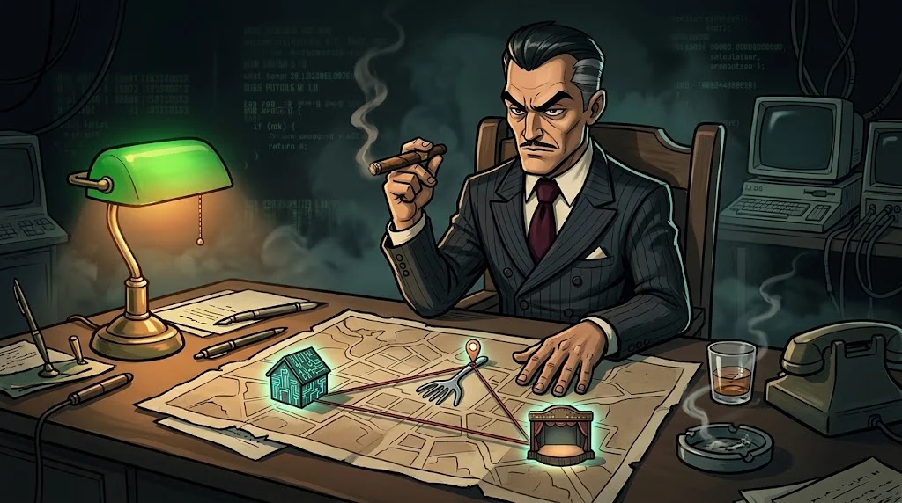

# Yol haritası ve takvim

> Program iki dönem sürer. Etkinlik ve tatil haftalarıyla birlikte takvimde yaklaşık **33 hafta** eder.

## 1. dönem — Ortak temel

| Hafta | Konu |
|---|---|
| 1 | Siber güvenliğe giriş |
| 2 | Etik, hukuk ve gizlilik |
| 3 | İşletim sistemi güvenliği |
| 4 | Linux |
| 5–6 | Ağ temelleri |
| 7 | Web teknolojileri |
| 8 | Python |
| 9 | Kriptografi |
| 10 | OSINT |
| 11 | Saldırı ve savunma temelleri |
| 12 | Mini CTF ve değerlendirme |
| 13 | Serbest pratik / telafi |
| 14 | 🎉 Kampüs 404 etkinliği |
| 15 | Uzmanlık seçimi |

## 2. dönem — Uzmanlık ve proje

| Hafta | Konu |
|---|---|
| 16–27 | Seçtiğin yolun 12 dersi |
| 28–33 | Bitirme projesinin 6 aşaması ve Demo Day |

## İpucu

Bir haftayı kaçırırsan panik yok: 13. hafta tam da bunun için **telafi haftası**.
