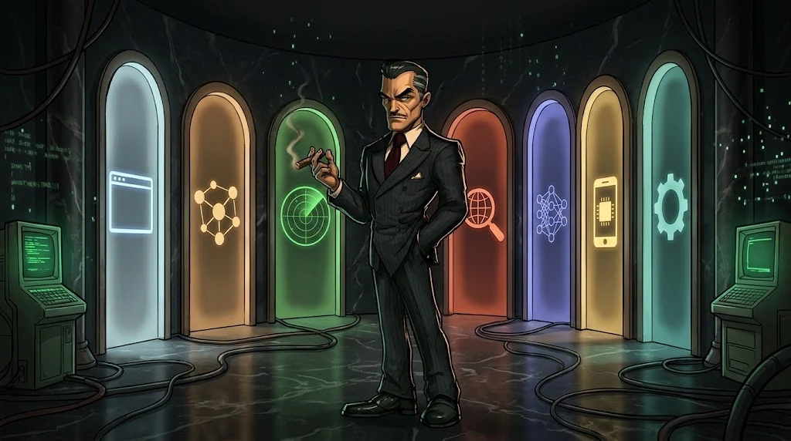

# Hangi uzmanlık yolu sana göre?

> 15. haftada **bir** yol seçersin. Hepsini öğrenmek zorunda değilsin; derinleşmek daha değerlidir.

| Yol | Seni ne heyecanlandırıyorsa | Ön koşul |
|---|---|---|
| **A — Web ve API Güvenliği** | Bir sitenin nerede kırıldığını bulmak | HTTP, web, Linux |
| **B — Ağ ve Sistem Güvenliği** | Ağları, sunucuları, Active Directory'yi anlamak | Ağ, Linux, Windows |
| **C — SOC, Olay Müdahalesi, Adli Bilişim** | Alarmları incelemek, saldırının izini sürmek | İşletim sistemleri, ağ, log okuma |
| **D — OSINT ve Tehdit İstihbaratı** | Bilgiyi doğrulamak, saldırgan davranışını analiz etmek | OSINT, ağ, Linux |
| **E — Yapay Zekâ ve LLM Güvenliği** | Chatbotların ve AI ajanlarının nasıl kandırıldığını görmek | API, Python, web |
| **F — Mobil, IoT ve Gömülü Sistemler** | Uygulamaların ve akıllı cihazların içini açmak | İşletim sistemleri, ağ, programlama |
| **G — Zararlı Yazılım ve Tersine Mühendislik** | Bir programın gerçekte ne yaptığını çözmek | Linux, Windows, Python |

## Kararsız mısın? Üç soru sor

1. Temel kısımda hangi haftada **zamanın nasıl geçtiğini fark etmedin**?
2. **Bulmak** mı (A, B, F, G), **savunmak** mı (C), **araştırmak** mı (D, E) daha çok çekiyor?
3. Bitirme çıktısı olarak hangi dosyayı portfolyonda görmek isterdin?

Her yolun tanıtım sayfası: [Uzmanlık yolları](../02-uzmanlik/).

## Unutma

Hiçbir yol "daha iyi" değil. Güvenlik ekipleri bu rollerin **hepsine** ihtiyaç duyar.
