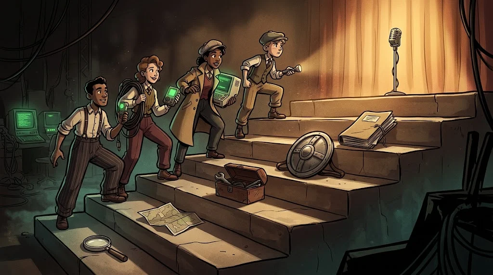

# Capstone project and Demo Day

> The last six weeks are where you turn what you've learned into **a real security process**.

::cizgi[p-06-sahne]

## Six weeks, six steps

| Week | Stage | Output |
|---|---|---|
| 1 | **Case and team** — fictional organisation, asset inventory, scope, roles | Project plan |
| 2 | **First review** — initial findings, risks | Progress report |
| 3 | **Deep dive** — verification, evidence quality, filtering out false results | Verified findings |
| 4 | **Defence** — design a control, apply it, prove that it works | Before/after comparison |
| 5 | **Report** — executive summary, methodology, findings, risk, recommendations | Final report |
| 6 | **🎤 Demo Day** — presentation, live demo, jury questions | Portfolio |

## What does the jury look for?

- Did you understand the problem correctly?
- Are your findings **backed by evidence**?
- Does the defence you proposed actually work?
- Can you explain it to someone non-technical?

## The goal

To become someone who doesn't memorise terms, but who can **analyse and explain** a security problem.
Your report and presentation become the first portfolio piece you can show in internship and job applications.
