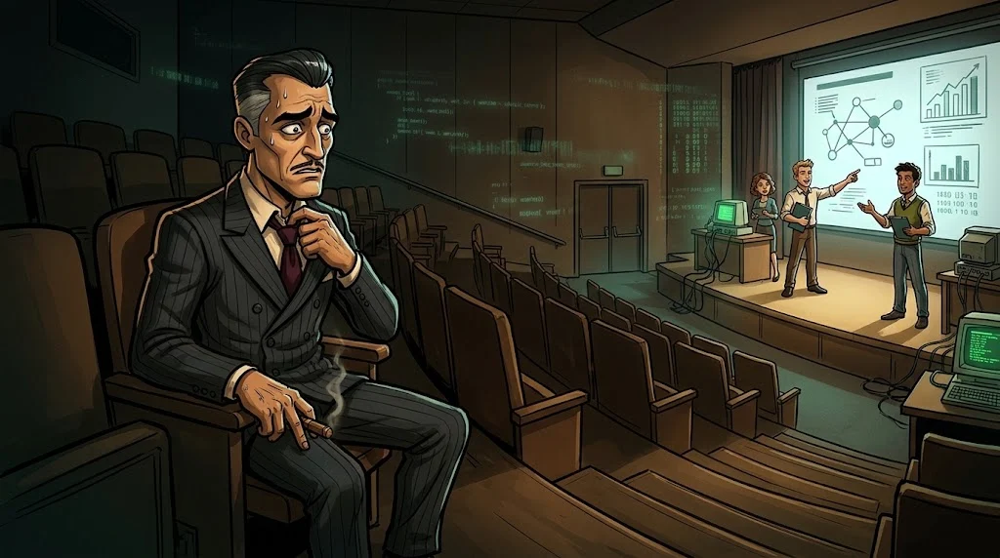

# Bitirme projesi ve Demo Day

> Son altı hafta, öğrendiklerini **gerçek bir güvenlik sürecine** dönüştürdüğün yerdir.

## Altı hafta, altı adım

| Hafta | Aşama | Çıktı |
|---|---|---|
| 1 | **Vaka ve takım** — kurgusal kurum, varlık envanteri, kapsam, roller | Proje planı |
| 2 | **İlk inceleme** — ilk bulgular, riskler | İlerleme raporu |
| 3 | **Derinlemesine çalışma** — doğrulama, kanıt kalitesi, hatalı sonuçları ayıklama | Doğrulanmış bulgular |
| 4 | **Savunma** — önlem tasarla, uygula, işe yaradığını kanıtla | Önce/sonra karşılaştırması |
| 5 | **Rapor** — yönetici özeti, metodoloji, bulgular, risk, öneriler | Final raporu |
| 6 | **🎤 Demo Day** — sunum, canlı gösterim, jüri soruları | Portfolyo |

## Jüri neye bakar?

- Problemi doğru anladın mı?
- Bulguların **kanıtlı** mı?
- Önerdiğin savunma gerçekten çalışıyor mu?
- Teknik olmayan birine anlatabiliyor musun?

## Hedef

Terimleri ezberleyen biri değil; bir güvenlik problemini **analiz edip açıklayabilen** biri olmak.
Raporun ve sunumun, staj ve iş başvurularında gösterebileceğin ilk portfolyo parçan olur.
