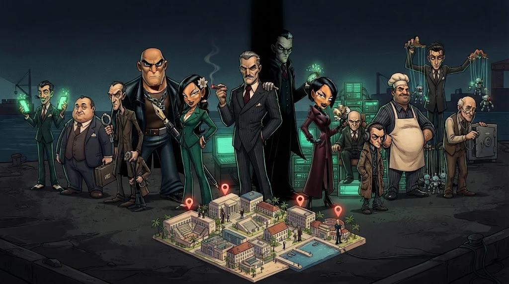

# KKTC kampüs senaryoları

> Derslerdeki vakalar KKTC'deki üniversite hayatına benzer ama **tamamen kurgusaldır**.
> Gerçek kurum taklit edilmez, gerçek kişisel veri kullanılmaz.

| # | Senaryo | Seviye | Konu |
|---|---|---|---|
| 01 | **Sahte burs başvurusu** — "Burs kazandın!" mesajı hesap bilgilerini istiyor | Başlangıç | Phishing, OSINT |
| 02 | **Kampüs Wi-Fi gizemi** — simüle ağda güvenli ve güvensiz erişim noktaları | Başlangıç/Orta | Wi-Fi, MITM |
| 03 | **Kaybolan öğrenci dosyası** — kurgusal öğrenci sisteminde yanlış erişim kontrolü | Başlangıç/Orta | IDOR, yetkilendirme |
| 04 | **Şüpheli yurt bilgisayarı** — sentetik Windows logları ve ağ kaydı | Orta | SOC, adli bilişim |
| 05 | **Sahte kiralık ev ilanı** — ilan ile açık kaynak kayıtları uyuşmuyor | Başlangıç | OSINT, sosyal mühendislik |
| 06 | **Akıllı kampüs** — simüle aydınlatma, sensör ve enerji cihazları | İleri | IoT, OT, risk |

## Nasıl çalışırsın?

1. Vaka dosyasını oku, **soruyu** netleştir.
2. Kanıtları incele — her şey sentetik ve laboratuvarda.
3. Bulduğun her şeyi **neden** öyle düşündüğünle birlikte yaz.
4. Önleme önerisiyle bitir.

Senaryo 01 ve 05, temel kısımda (M01, M09) seni bekliyor.
