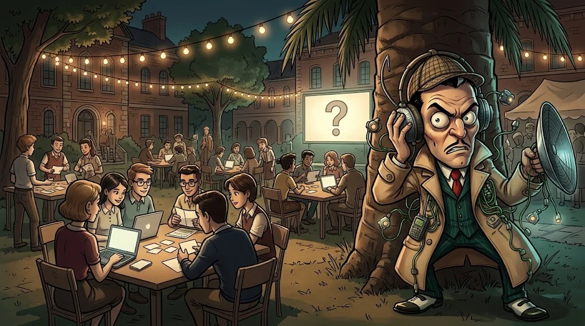

# Kampüs etkinlikleri

> Akademiye kayıtlı olmasan da katılabileceğin etkinlikler. **Sadece web tarayıcısı kullanabilmek yeter.**

## 🕵️ Kampüs 404 — Dijital Gizem
**90–120 dk · takım · her bölüm**

Kurgusal kampüsün arşivinden bir dosya kayboldu. Beş ipucuyla izini sür:
gizli mesajı çöz, sahte e-postayı ayırt et, görseldeki ipucunu bul, web sayfasındaki hatayı yakala,
olayın zaman çizelgesini tamamla. Her yıl yeni bir hikâye.

## 🔍 Cyber Detective
Silinmiş bir not, bir ekran görüntüsü, sahte bir sosyal medya hesabı ve dosya metadata'sı.
Teknik olmayan bölümlerden gelenler de mantık yürütme ve doğrulama ile katkı verir.

## 🛠️ Hack the Campus Lab
Kurgusal bir üniversite web uygulamasında eğitmen bir güvenlik hatasını gösterir;
sen etkisini gözlemler, ardından **düzeltmenin** gerçekten çalıştığını test edersin.

## 🔐 Parolanın Ardındaki Hikâye
Etkileşimli stand: phishing mesajlarını ayırt et, MFA yöntemlerini karşılaştır.
Gerçek parola veya giriş bilgisi **asla** istenmez.

Etkinlik takvimi kulüp duyurularında ve ana sayfada.
