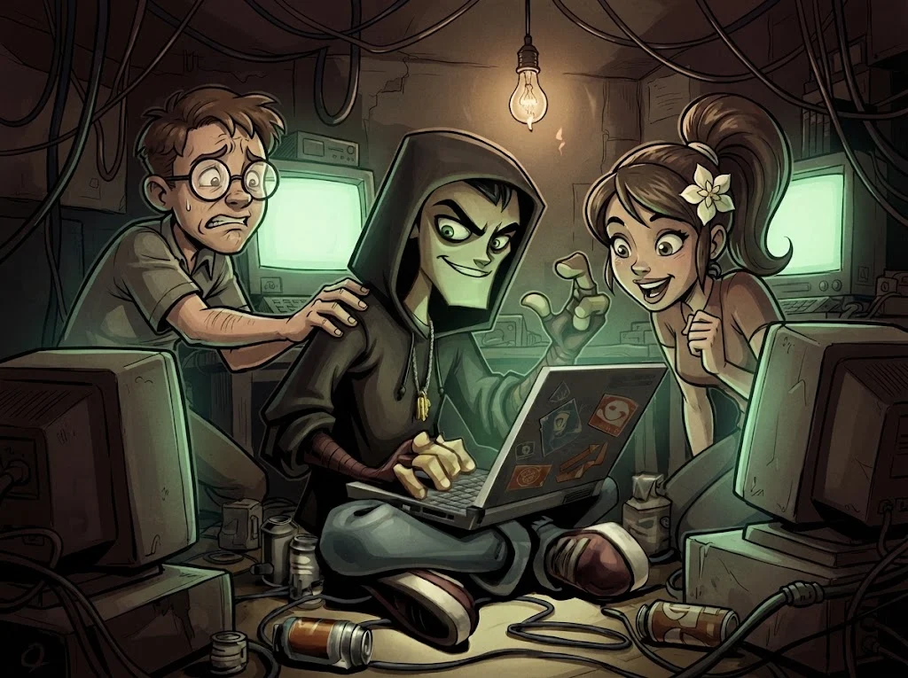
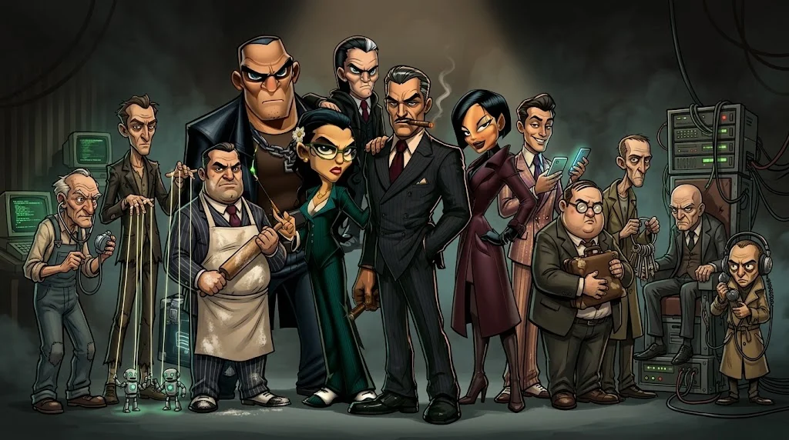

# Gölge Ağ: Akademinin hikâyesi

> Her modül bir bölüm, her kötü adam bir dosya. Sen bir **Kalkan** analistisin. Kod adın: **TİLKİ**.
> Tilki iz bırakmaz ama her izi okur.

## Yirmi yıl önce

Bir üniversitenin bodrum laboratuvarında üç genç: **Eren**, **Selim** ve **Jasmine**. Kendilerine *Kapüşonlular* diyorlar.
Bir gece liman bankasının sisteminde bir açık buluyorlar.

- **Selim:** "Bildirelim."
- **Eren:** "Bu bir anahtar. Anahtarı veren, kapıyı da verir."

Jasmine, Eren'in yanında duruyor. Sabah ikisi de yok. Masada tek satırlık bir not:
*"Kapı açıktı. Ben sadece içeri girdim. — E."*

## Bugün

Liman şehrinin eski kaçakçılık ailesi artık **Gölge Ağ**: dolandırıcılar, dinleyiciler, kasa kıranlar, fidyeciler.
Ailenin görünen başı **Don Gölge**. Ama Don bile birine borçlu: yüzünü kimsenin görmediği **Baron**.

Selim artık bir hoca. Kampüste **Kalkan**'ı kurdu: saldırmayan, savunan; delil toplayıp yetkililere teslim eden bir ekip.
Ve bu dönem seni seçti.

## Kalkan'ın üç kuralı

1. **İzin yoksa tek tuşa basılmaz.** Avukat Kemal tam olarak bunu bekliyor.
2. **Saldırıya saldırıyla cevap verilmez.** Kapı kapatılır, delil saklanır, rapor yazılır.
3. **Her dosya bir ders.** Hileyi anlamadan kötü adamı durduramazsın.

## Kim kime bağlı?

- **Baron Eren** Don'u büyüttü; sağ eli **Tek Tırnak Jasmine**, onun çırağı **Kuklacı Orhan**.
- **Don Gölge**'nin kızı **Maskeli Mine**, yeğeni **Tatlı Dil Tevfik**, sağ kolu **Fidyeci Ferhat**.
- **Avukat Kemal** herkesin sırrını bilir — ama gizlice Mine'ye çalışır.
- **Anahtarcı Rıza** ile **Kasa Kıran Kadir** aynı koğuştan çıktı.
- **Süper Kullanıcı Sadri**, genç Eren'e ilk terminalini açan adam.
- **Çerezci Celal**'in fırını ailenin buluşma yeri; kuzeni **Dinleyici Nuri** fırının Wi-Fi'ını dinler.

## Gölge Ağ — Sezon 1: dosyalar

| Bölüm | Başlık | Dosya | Modül |
|---|---|---|---|
| 1 | [Bursun Onaylandı](../01-temel/m01-dijital-tehlikeler/01-neden-onemli.md) | Tatlı Dil Tevfik | M01 |
| 2 | [Yetki Belgesi](../01-temel/m02-etik-ve-hukuk/01-izin-farki.md) | Avukat "Boşluk" Kemal | M02 |
| 3 | [Ana Anahtar](../01-temel/m03-isletim-sistemi/01-bilgisayar-katmanlari.md) | Anahtarcı Rıza | M03 |
| 4 | [Kök](../01-temel/m04-linux/01-linux-ve-terminal.md) | Süper Kullanıcı Sadri | M04 |
| 5 | [Fırındaki Kulak](../01-temel/m05-aglar/01-internet-nasil-calisir.md) | Dinleyici Nuri | M05 |
| 6 | [Taze Çerezler](../01-temel/m06-web/01-web-nasil-calisir.md) | Çerezci Celal | M06 |
| 7 | [İpler](../01-temel/m07-python/01-merhaba-python.md) | Kuklacı Orhan | M07 |
| 8 | [Kasa](../01-temel/m08-kriptografi/01-sifreleme-neden.md) | Kasa Kıran Kadir | M08 |
| 9 | [Maskeler](../01-temel/m09-osint/01-osint-ve-etik.md) | Maskeli Mine | M09 |
| 10 | [Fidye](../01-temel/m10-saldirilar/01-tehdit-zafiyet-risk.md) | Fidyeci Ferhat | M10 |
| 11 | [Son Masa](../01-temel/m11-mini-ctf/01-ilk-operasyon.md) | Don Gölge | M11 |

> 📼 Her modülün ilk sayfası bölümü açar; son sayfası dosyayı kapatır ve **bir sonraki kötü adama giden ipucunu** verir.
> On bir dosyayı kapatan, Baron'un kapısına ulaşır.

## Sezon 2: uzmanlık yolları

Her uzmanlık yolu yeni bir dosya açar ve Kapüşonlular'ın geçmişinden bir parça daha gösterir.

| Yol | Başlık | Dosya |
|---|---|---|
| A | [Çekmeceler](../02-uzmanlik/yol-a-web/00-genel-bakis.md) | Tek Tırnak Jasmine |
| B | [Tüneller](../02-uzmanlik/yol-b-ag/00-genel-bakis.md) | Tünelci Tarık |
| C | [Temizlik](../02-uzmanlik/yol-c-soc/00-genel-bakis.md) | Temizlikçi Tamer |
| D | [Sahte Bayraklar](../02-uzmanlik/yol-d-cti/00-genel-bakis.md) | Bayrakçı Bedri |
| E | [Ayna](../02-uzmanlik/yol-e-ai/00-genel-bakis.md) | Vantrolog Veysel |
| F | [Gözler](../02-uzmanlik/yol-f-mobil-iot/00-genel-bakis.md) | Lehimci Leman |
| G | [Saat İşliyor](../02-uzmanlik/yol-g-tersine/00-genel-bakis.md) | Saatçi Sabri |
