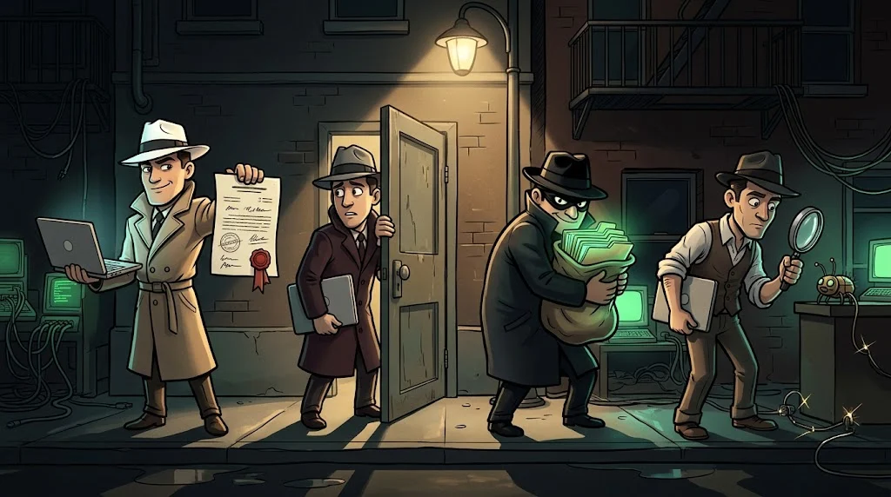
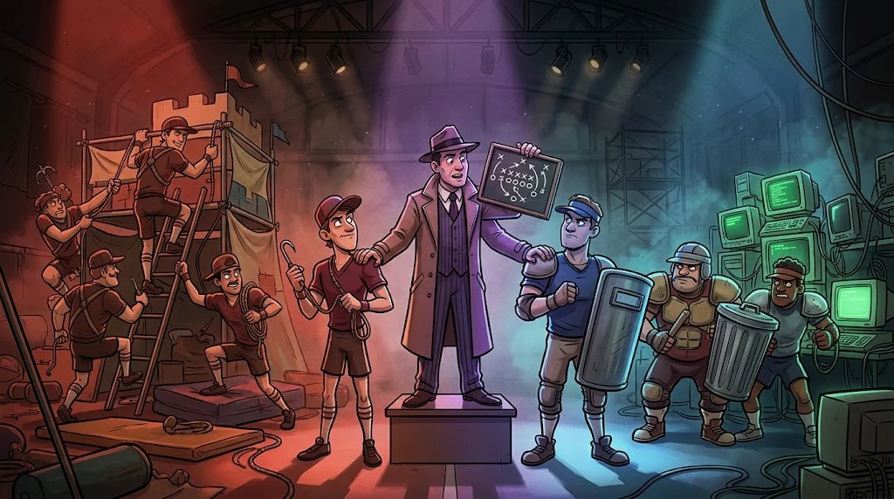

# Who is a hacker?

> Forget the hooded character from the movies. A "hacker" is someone **deeply curious about how a system works**.
> What they do, and **with whose permission**, is what makes them good or bad.

::cizgi[m01-02-sahne]

## Four types

| Who? | What do they do? | Permission? |
|---|---|---|
| **Ethical hacker** (white hat) | Looks for vulnerabilities with organisations' permission and reports them | ✅ With written permission |
| **Cybercriminal** (black hat) | Attacks for money, data or to cause harm | ❌ |
| **Gray hat** | Looks for vulnerabilities without permission; usually reports them without causing harm, sometimes asks for money in return | ❌ Good intentions don't replace permission |
| **Security researcher** | Finds new vulnerabilities in software and reports them to the vendor | ✅ Through responsible disclosure |

The difference **isn't technical — it's ethical and legal**. The same tool can be in either side's hands.

## Teams: who tests whom?

- 🔴 **Red Team** — Imitates the attacker. Thinks "how do I get in?"
- 🔵 **Blue Team** — Defends. Watches alerts, closes vulnerabilities, responds to incidents.
- 🟣 **Purple Team** — Brings the two together: makes sure blue **can detect** what red found.

Think of a match: if attack and defence don't learn from each other, the team doesn't improve.

## Which one are you?

You don't need to know yet. The core part of the academy opens doors to all three sides;
in week 15 you'll choose a direction.

## 🧪 Try it (3 min)

Match the sentences below to the teams:

1. "Let's see whether the company's email filter catches this fake email."
2. "There were lots of failed logins on a server at 3 a.m. last night; I'm looking into it."
3. "Let's add the method used in the test to our detection rules."

Answer
1 → Red · 2 → Blue · 3 → Purple

## ✅ Remember

- Hacker = someone who curiously understands systems in depth.
- **Permission and intent** separate good from bad; good intentions without permission (gray hat) are still illegal.
- Red attacks, Blue defends, Purple brings them together.
