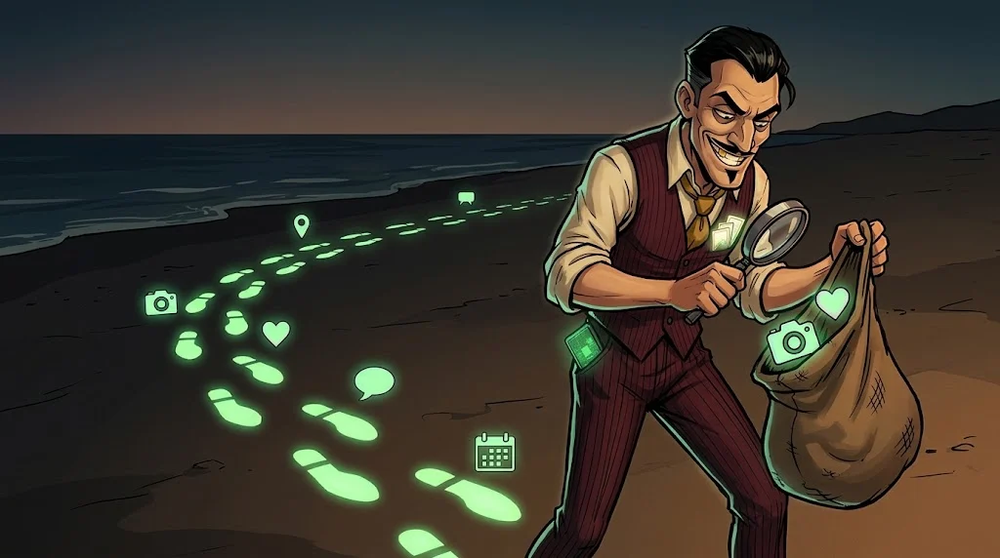

# Dijital ayak izin seni nasıl ele verir?

> Paylaştığın her fotoğraf, beğeni ve konum bir **iz** bırakır.
> Tek başına zararsız görünen izler yan yana gelince bir hikâye anlatır.

## Üç kavram

- **Dijital kimlik** — İnternette "sen" olarak tanınan her şey: hesapların, kullanıcı adların, e-postan.
- **Dijital ayak izi** — Bıraktığın izler.
  - *Aktif:* kendi paylaştıkların.
  - *Pasif:* farkında olmadan bıraktıkların — konum geçmişi, çerezler, uygulama izinleri.
- **Çevrimiçi itibar** — Bu izlerden başkalarının senin hakkında çıkardığı sonuç (ör. işe alım yapanlar).

## Bir dolandırıcı neler öğrenebilir?

Şu üç paylaşımı düşün:

1. Yeni kampüs kartının fotoğrafı 📸
2. "Burs sonuçlarını bekliyorum 🤞" hikâyesi
3. Yurt odası penceresinden manzara

Birleşince: **hangi okulda olduğun, burs beklediğin ve nerede kaldığın.**
Bu, sana özel hazırlanmış bir sahte burs mesajı için yeterlidir (bkz. sonraki sayfalar).

## İzini küçültmenin yolları

- Hesap gizlilik ayarlarını gözden geçir; profilini "herkese açık"tan çıkar.
- Kimlik, kart, bilet, bilet barkodu fotoğrafı **paylaşma**.
- Konumu anlık değil, **sonradan** paylaş.
- Kullanmadığın uygulamaların izinlerini kaldır, hesaplarını kapat.

## 🧪 Dene (5 dk)

Bir arama motoruna **adını soyadını tırnak içinde** yaz ve ilk iki sayfaya bak.
Neyi bulmak seni şaşırttı? Kaldırmak istediğin bir şey var mı?

## ✅ Akılda kalsın

- Her paylaşım bir iz; izler birleşince hikâye anlatır.
- Pasif izler (konum, izinler) en az fark edilenlerdir.
- Az paylaş, geç paylaş, gizli paylaş.
