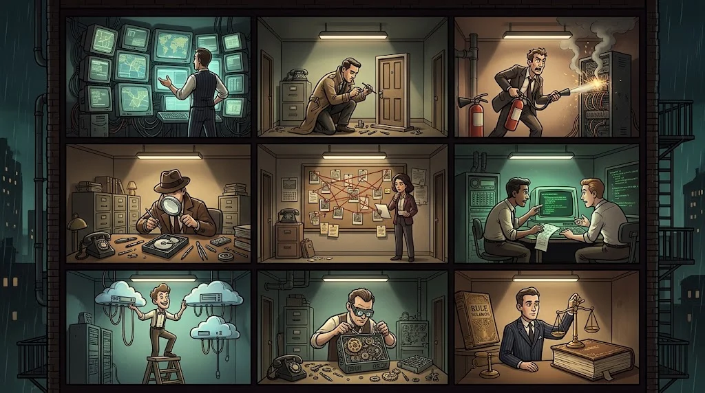

# Siber güvenlikte hangi işler var?

> Siber güvenlik tek bir meslek değil, **bir sürü meslekten oluşan bir şehir**.
> Kod yazmayı sevmesen bile bir köşesi sana göre olabilir.

::cizgi[m01-06-sahne]

| Rol | Bir günü nasıl geçer? | Akademideki yolu |
|---|---|---|
| **SOC analisti** | Alarmları inceler, gerçek tehdidi ayıklar | C |
| **Sızma testi uzmanı** (pentester) | İzinle sistemlere saldırır, rapor yazar | A, B |
| **Olay müdahalecisi** | Saldırı anında ne olduğunu bulur, durdurur | C |
| **Adli bilişim uzmanı** | Dijital delilleri inceler | C |
| **Tehdit istihbarat analisti** | Saldırgan gruplarını ve yöntemlerini izler | D |
| **Uygulama güvenliği mühendisi** | Geliştiricilerle güvenli kod yazdırır | A |
| **Bulut / AI güvenliği** | Yeni teknolojilerin risklerini yönetir | E |
| **Tersine mühendis** | Zararlı yazılımın içini çözer | G |
| **Güvenlik danışmanı / GRC** | Politika, risk ve uyumluluk | Tüm yollar + M02 |

## İşe alımda ne sayılır?

- **Gösterebildiğin** işler: raporlar, CTF çözümleri, küçük projeler → bitirme projen tam da bu.
- Temel bilgi: işletim sistemi, ağ, web. → Temel kısım bunun için.
- İletişim: Bulduğunu teknik olmayan birine anlatabilmek.

Sertifikalar faydalıdır ama **portfolyonun yerini tutmaz**.

## 🧪 Dene (3 dk)

Tablodan seni en çok çeken **iki** rolü seç. Her biri için "neden?" sorusuna bir cümle yaz.
15. haftada yol seçerken bu notuna geri dön.

## ✅ Akılda kalsın

- Savunma, saldırı, araştırma, yönetim: her eğilime bir rol var.
- Gösterilebilir iş > sadece sertifika.
- Temel bilgi her rolün ortak dilidir.
