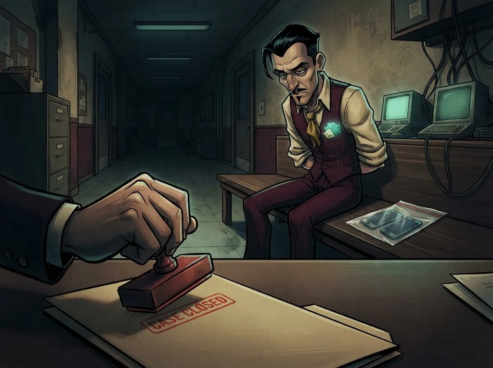

# M01 Quiz: Dijital tehlikeler

7 soru · geçme notu %70 · istediğin kadar tekrar deneyebilirsin.

> 🔒 **DOSYA KAPANDI: Tatlı Dil Tevfik** · *quiz'i %70 ile geçince*
>
> 
>
> Tevfik'in tuzağı boşa çıktı, sahte site kapandı. Ama telefonundaki son arama bir avukat bürosuna gidiyor: "Kemal Bey, bir çocuk izimize düştü."
>
> ➡️ *Sıradaki dosya: **Avukat "Boşluk" Kemal** (M02)*
