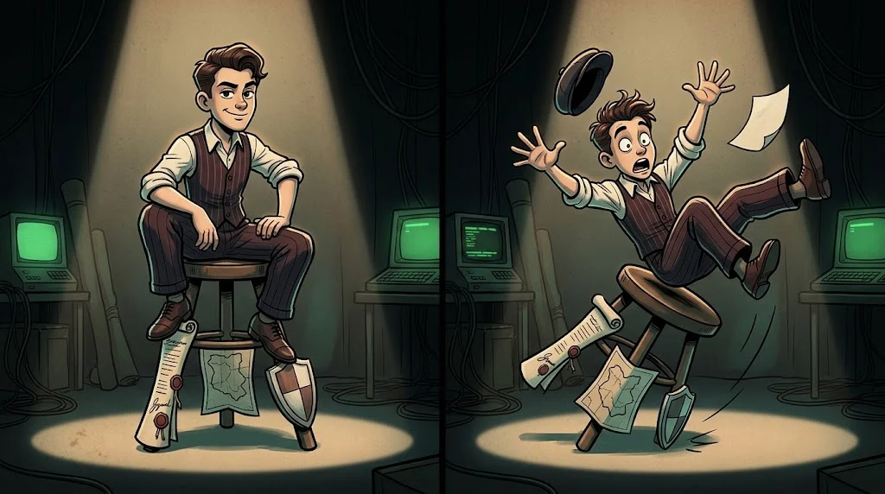

# The same command, two different outcomes

> The command you type to look for a flaw on a website is a job if it is run **with permission**,
> and a crime if it is run **without permission**. The command is the same; the difference is in the authorization.

::cizgi[m02-01-sahne]

> 🕴️ **FILE: Lawyer "Loophole" Kemal** · *Crooked Lawyer*
>
> 
>
> **Threat:** Unauthorised "testing", stepping outside the scope, "I only looked" excuses. · [Shadow Network story →](../../00-program/09-golge-ag.md)

::cizgi[kemal-acilis]

## The three conditions of ethical hacking

1. **Written permission** — From the owner of the system, signed and dated.
2. **Clear scope** — Which systems, which dates, which methods.
3. **Responsible conduct** — Causing no harm, protecting the data, reporting the finding only to the owner.

If one of these is missing, what you are doing is no longer a "test".

## Common mistakes

| "But…" | The reality |
|---|---|
| "I only looked, I didn't change anything." | Unauthorised **access** can be a crime on its own. |
| "It was a public website." | Being public does not grant permission to test. |
| "It was my friend's account, I told them afterwards." | Even the account owner's permission is not the **system** owner's permission. |
| "I found the flaw and warned the organisation." | Even with good intent, unauthorised testing carries legal risk. |

## So where do I practise?

On your own computer, in the club lab, in the Ördek Lab and on legal platforms intended for training.
These boundaries never change throughout the Academy.

## 🧪 Try it (3 min)

"I wondered how many devices are on the school Wi-Fi, so I scanned it" — which condition do you think this breaches?
Write it in one sentence.

Answer
All three: there is no written permission, no scope, and it touches other people's devices.

## ✅ Remember

- It is not technique that separates a test from a crime, but **authorization**.
- Written permission + clear scope + responsible conduct = an ethical test.
- "I only looked" is not a defence.
