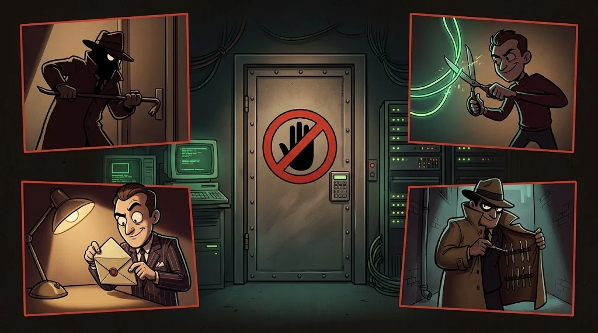

# Cybercrimes and personal data in the TRNC

> While working in cyber security you always ask two questions: **"Am I authorized to do this?"** and
> **"Am I obliged to protect this data?"** The law answers both.

::cizgi[m02-02-sahne]

> ⚖️ **Instructor note:** This page is a general summary, not legal advice.
> Before the lesson, check the legislation and law numbers currently in force in the Official Gazette.

## Cybercrimes

TRNC legislation (in the curriculum: *Bilişim Suçları Yasası*) generally treats the following as crimes:

- **Entering** an information system **without permission**, or remaining there without permission
- **Corrupting, deleting or altering** data, or making the system unusable
- **Obtaining** someone else's data or communications **without permission**
- **Obtaining or distributing** tools and passwords for these purposes

So the question **"was there permission?"** comes before the question "how much harm did you cause?".

## Protection of personal data

In the TRNC, personal data is protected by the **Kişisel Verilerin Korunması Yasası**. In essence:

- Data is collected for a **specific and legitimate purpose** and is not used for anything else.
- It is collected **only as much as necessary** and kept only as long as necessary.
- The data controller is obliged to **protect the data against unauthorised access**.
- A person has the right to learn about and correct the data held about them.

## Universities and student data

Student numbers, grades, medical reports, scholarship and payment details are **personal data**.
The university is responsible for protecting them, and you are responsible for protecting any data you access —
even as a club officer, assistant or intern.

## 🧪 Try it (3 min)

Write down five types of data your school collects from you. Which one would upset you most if it leaked? Why?

## ✅ Remember

- Unauthorised access can be a crime even if you cause no harm.
- Personal data: limited to its purpose, only as much as necessary, stored securely.
- Always verify the text of the law from an up-to-date source.
