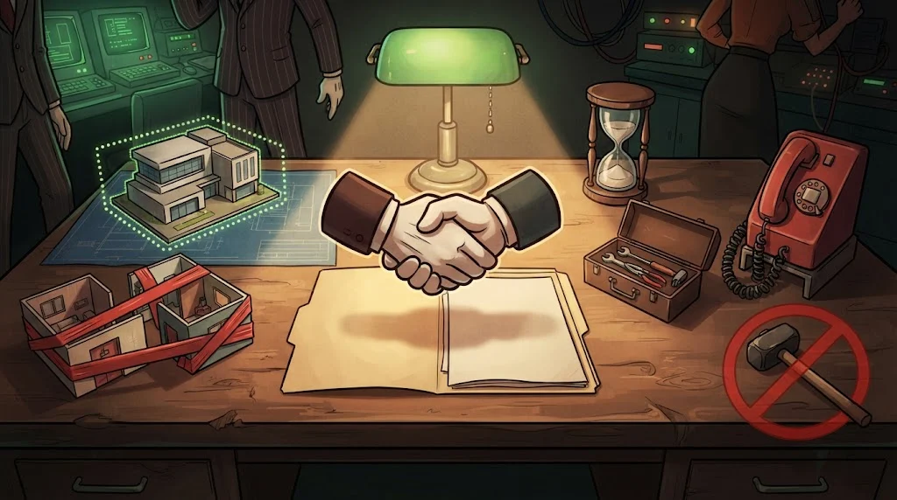

# How do you plan an authorised test?

> A good test starts **before** the first command: on paper.
> Professionals call this the *Rules of Engagement*.

::cizgi[m02-03-sahne]

## The 7 parts of written permission

| Part | Example |
|---|---|
| **Parties** | The system owner and the person/team testing, with their signatures |
| **Scope** | `test.kuzeykiyi.edu.example` — this address only |
| **Out of scope** | The email server, the student portal, physical buildings |
| **Time** | 3–5 March, 09:00–17:00 |
| **Permitted methods** | Web application testing, manual review |
| **Prohibited activities** | Denial of service, deleting data, social engineering |
| **Contact** | The person to call in an emergency and the procedure for stopping the test |

## Why do prohibited activities matter?

Not everything is allowed even within scope. The most commonly prohibited ones:

- Tests that slow down or stop the system (DoS)
- Downloading or storing real user data
- Attempts to deceive staff (unless separately authorised)
- Taking a found flaw further than the evidence requires

## What if something goes wrong?

**Stop, document, report.** Stop the test immediately, note what you did with the time, and call the contact.
Trying to hide it always makes the situation worse.

## 🧪 Try it (4 min)

According to the example in the table: during the test you noticed an error on the login page of the student portal.
What do you do?

Answer
The portal is out of scope: don't touch it, don't test it. Note your observation and report it to the contact; the system owner decides whether it will be added to the scope.

## ✅ Remember

- A test begins on paper: scope, time, method, prohibitions.
- Even "a quick look" outside the scope is a breach.
- If there's a problem: stop, document, report.
