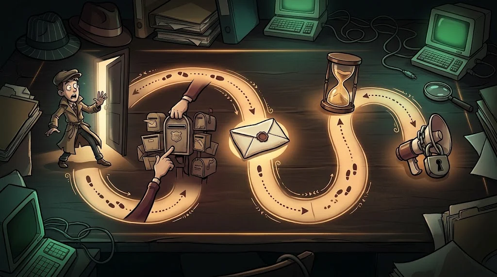

# What do you do if you find a vulnerability?

> Finding a vulnerability is half the job. The other half is telling **the right person in the right way**.

::cizgi[m02-04-sahne]

## Responsible disclosure

1. **Stop.** Don't use the vulnerability any further, don't download data.
2. **Find the right channel.** A `security.txt` file on the site, a "security report" page, or a bug bounty programme.
3. **Write clearly and briefly.** What it is, where it is, what the impact is, how to reproduce it — without adding personal data.
4. **Allow time.** Give the organisation reasonable time to fix it (usually 90 days).
5. **Don't publish without permission.** Sharing details before a fix puts users at risk.

If the organisation doesn't respond for a long time, consult the club officers; don't go public on your own.

## Confidentiality of digital evidence

The logs, screenshots and files you see during a test or an incident investigation are **confidential**.

- Collect only as much as the work requires.
- Store it encrypted and with limited access.
- When the work is done, delete or hand it over according to the rules.

## Artificial intelligence and privacy

Pasting a log file or a draft report into an AI chat tool means **sending it to a third party**.

- **Don't paste** real personal data, passwords, internal IPs or organisation names.
- If necessary, mask the data first: `ogrenci@…` → `USER_1`.
- Follow your organisation's AI usage policy.

## 🧪 Try it (3 min)

Open `https://www.google.com/.well-known/security.txt` in a browser.
What does a security researcher learn from this file?

## ✅ Remember

- Find the vulnerability, stop, report it through the right channel, allow time.
- Evidence is confidential: collect little, store it safely, clean up when the work is done.
- Anything you paste into an AI tool counts as sent outside.
