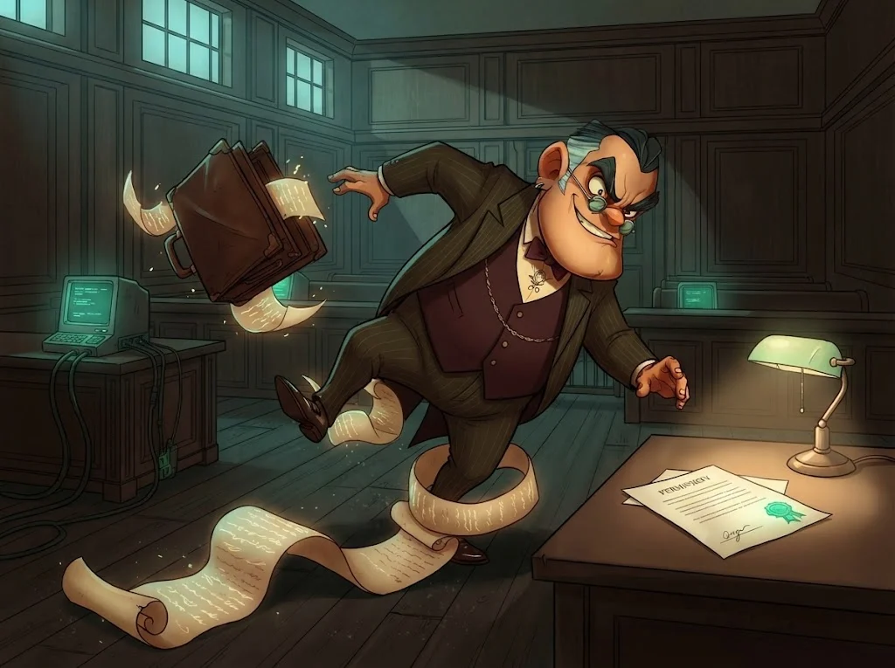

# M02 Quiz: Etik ve hukuk

6 soru · geçme notu %80. Bu modül başarı belgesi için **zorunludur**.

> 🔒 **DOSYA KAPANDI: Avukat "Boşluk" Kemal** · *quiz'i %80 ile geçince*
>
> 
>
> Tuzağa düşmedin; dosyandaki her delil imzalı ve izinli. Kemal masasındaki eski fotoğrafı çeviriyor: aynı koğuştan iki adam — bir çilingir ve bir kasa hırsızı.
>
> ➡️ *Sıradaki dosya: **Anahtarcı Rıza** (M03)*
