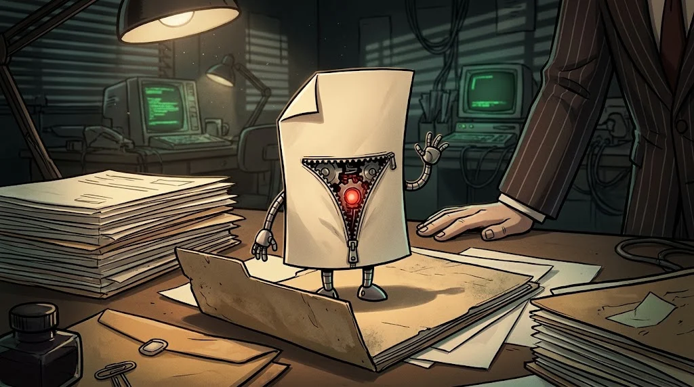

# The layers of your computer and the real name of files

> An attacker deceives you at the "application" layer, but their real target is the layer underneath.
> Anyone who knows the layers can see where the trick is.

::cizgi[m03-01-sahne]

> 🕴️ **FILE: Locksmith Rıza** · *The Lockpick*
>
> 
>
> **Threat:** Taking over administrator rights, hiding at startup (persistence), fake file extensions. · [Shadow Network story →](../../00-program/09-golge-ag.md)

::cizgi[riza-acilis]

## Four layers

1. **Hardware** — processor, memory, disk, network card.
2. **Operating system** (OS) — manages the hardware; files, users and permissions are its job.
3. **Applications** — browser, Word, games. They run by asking the OS for permission.
4. **You** — you decide what to click. The layer an attacker works on most.

## Windows or Linux?

| | Windows | Linux |
|---|---|---|
| Where? | Home and office computers | Servers, the cloud, security tools |
| Administrator | Administrator | root |
| Updates | Windows Update | Package manager (`apt`, `dnf`) |

A security professional knows **both**; attacks and defences look different on each.

## The extension trick

Windows **hides** known extensions by default. So `odev.pdf.exe` looks like `odev.pdf` to you —
but when you open it, a program runs.

Risky extensions: `.exe` `.scr` `.bat` `.cmd` `.js` `.vbs` `.lnk` `.iso` and `.docm` / `.xlsm` with macros.

## 🧪 Try it (2 min)

Turn on **file name extensions** on your own computer (macOS: Finder → Settings → Advanced).
Is there a file in your Downloads folder that surprises you?

## ✅ Remember

- Hardware → operating system → application → user.
- Always make extensions visible.
- A file with a double extension (`.pdf.exe`) = red alert.
