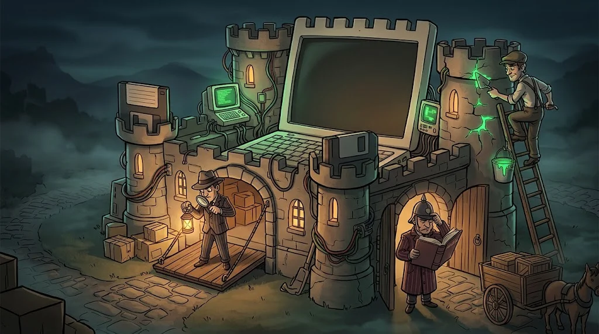

# Defender, güvenlik duvarı ve güncellemeler

> Windows'un içinde ücretsiz bir koruma ekibi zaten var. Çoğu zaman tek yapman gereken
> **kapatmamak** ve **güncel tutmak**.

::cizgi[m03-04-sahne]

## Üç koruma

| Koruma | Ne yapar? |
|---|---|
| **Microsoft Defender** | Dosyaları ve davranışları tarar, bilinen zararlıları durdurur |
| **Güvenlik duvarı** (firewall) | Ağdan gelen ve giden bağlantılara kurala göre izin verir veya engeller |
| **Güncellemeler** | Bilinen açıkları kapatan yamaları yükler |

Güvenlik duvarı nasıl karar verir? Kurallar sırayla kontrol edilir, eşleşen ilk kural uygulanır:

::animasyon[firewall-decision]

## Güncelleme neden bu kadar önemli?

Bir açık duyurulduğunda saldırganlar da öğrenir. Yamayı geciktiren her gün,
**herkesin bildiği bir açıkla** dolaşmak demektir. Büyük saldırıların çoğu,
yaması aylar önce çıkmış açıklardan yararlanır.

- Otomatik güncellemeyi açık tut.
- "Yeniden başlat" uyarısını günlerce erteleme.
- Sadece Windows değil: tarayıcı, PDF okuyucu, uygulamalar da güncellenir.

## Kötü fikirler

- Bir oyun veya "crack" kurmak için Defender'ı kapatmak
- Güvenlik duvarını "internet yavaş" diye kapatmak
- Desteği bitmiş işletim sistemi kullanmak (artık yama gelmez)

## 🧪 Dene (3 dk)

Windows Güvenliği'ni aç. Sarı veya kırmızı uyarı var mı? Varsa ne olduğunu oku ve düzelt.
Sonra Ayarlar → Windows Update'te bekleyen güncelleme var mı bak.

## ✅ Akılda kalsın

- Yerleşik korumalar yeterince iyidir; kapatma.
- Güvenlik duvarı kurallarla, ilk eşleşen kurala göre karar verir.
- Yama geciktiren, bilinen bir açıkla dolaşır.
