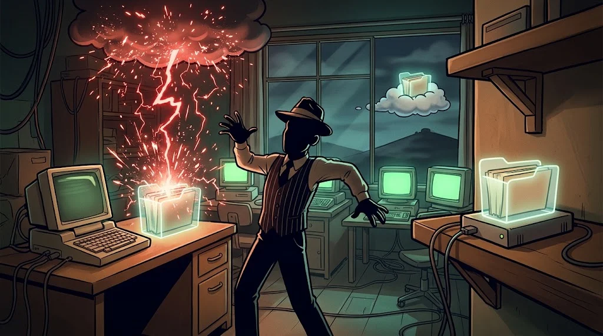
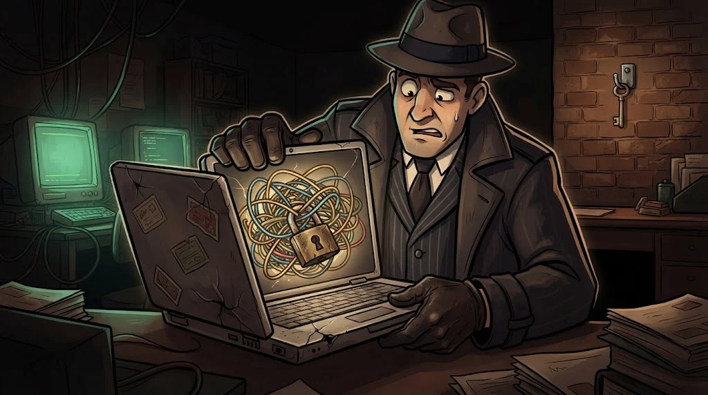

# Virtual machines, backups and disk encryption

> You will learn by breaking things. The way to do that **without breaking your own computer**: a virtual machine.

::cizgi[m03-05-sahne]

## Virtual machine (VM)

A second computer that runs inside your computer, **isolated** from it. It is set up with VirtualBox or VMware.

Its best feature is the **snapshot**: you save the VM's state at that moment,
and whatever happens you return with one click.

In the lab, malware, a vulnerable application or a risky command is **always** tried in a VM.

## Backup: the 3-2-1 rule

- **3** copies (the original + 2 backups)
- On **2** different media (e.g. external disk + cloud)
- **1** of them somewhere else, not connected to the computer

Ransomware can encrypt connected disks too; that is why the "not connected" part matters.
If you have never **tried restoring** a backup, you are not sure the backup exists.

## Disk encryption

If your laptop is stolen, the thief can remove the disk and plug it into another computer.
If the disk is encrypted, the files cannot be read.

- Windows: **BitLocker** or **Device encryption**
- macOS: **FileVault** · Linux: **LUKS** during installation

⚠️ Save the recovery key somewhere safe; if you lose it, you won't be able to open your files either.

## 🧪 Try it (3 min)

Settings → Privacy and security → is **Device encryption** (or BitLocker) on?
When did you last take a backup? Write the answer in one sentence.

## ✅ Remember

- Everything risky is tried in a VM, with a snapshot taken.
- 3-2-1: three copies, two media, one offline.
- Disk encryption protects the data on a stolen device; look after the recovery key.
