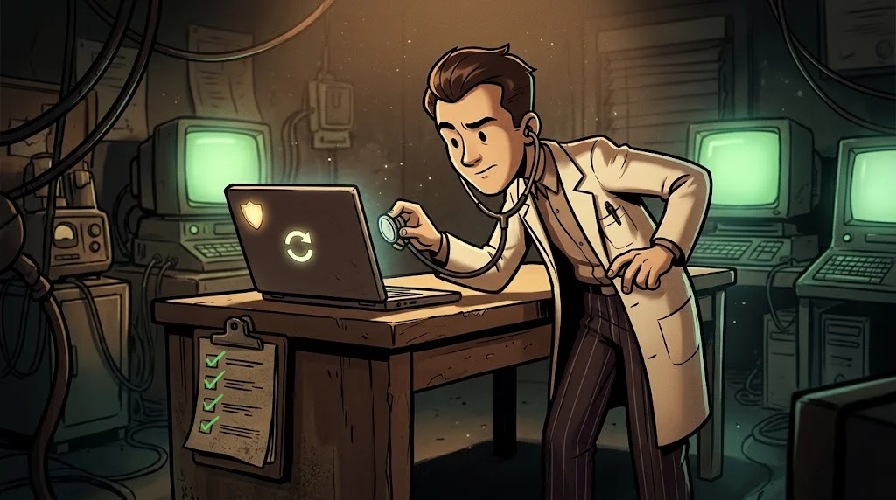

# Practice: How secure is my computer?

> The Windows virtual machine called **"Yurt-PC"** in the lab was deliberately set up with some faults.
> Examine it, make a diagnosis, recommend a treatment.

::cizgi[m03-06-sahne]

## Checklist



| # | Check | Where do you look? |
|---|---|---|
| 1 | Is the user standard or administrator? | Settings → Accounts |
| 2 | Is Defender real-time protection on? | Windows Security |
| 3 | Is the firewall on in all profiles? | Windows Security → Firewall |
| 4 | Are there pending updates? | Windows Update |
| 5 | Are file extensions visible? | File Explorer → View |
| 6 | Is there a suspicious item at startup? | Task Manager → Startup |
| 7 | Is disk encryption on? | Settings → Privacy and security |
| 8 | Is there a screen lock and a password? | Settings → Accounts → Sign-in |

## Submission: A short findings report

One line for each problem:

```text
Finding | Risk (High/Medium/Low) | Why is it risky? | Recommended fix
```

Example:
```text
Firewall off in the "Public network" profile | High | On café/dorm networks the device stays open to the outside | Turn it on in all profiles
```

Order the report starting with **the riskiest finding**.

<details><summary>Instructor note: Deliberate faults on Yurt-PC</summary>Automatic sign-in with an administrator account · Firewall off in the public profile · Updates 3 months behind · Extensions hidden · `updater_svc.exe` at startup with an empty "Publisher" field (a harmless test file) · Disk encryption off. There is a screen lock (check: doesn't the student say "everything is wrong"?).</details>

## ✅ Remember

- A security check-up starts with a checklist.
- Every finding is written with its risk, the reason and a recommendation.
- The report starts with the riskiest finding.
