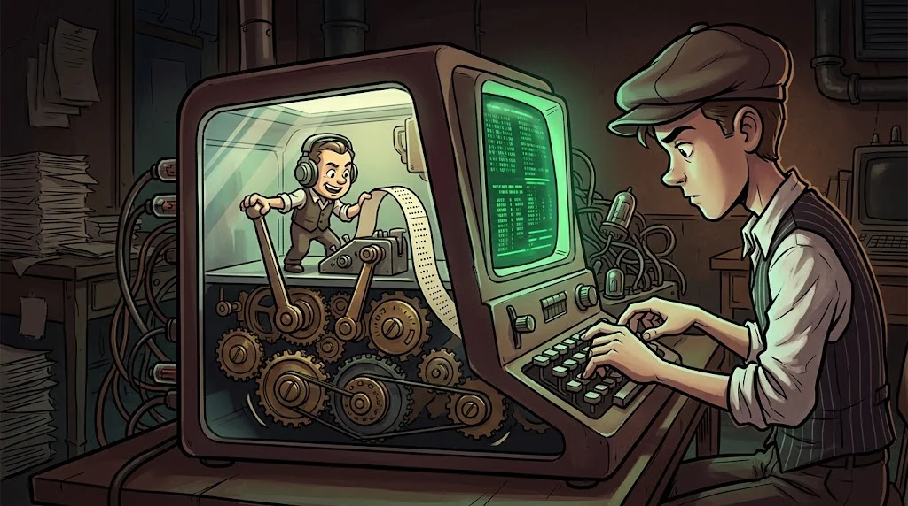

# Neden herkes Linux terminalinden bahsediyor?

> İnternetteki sunucuların büyük çoğunluğu Linux çalıştırır.
> Güvenlik araçlarının çoğu da orada yaşar. **Terminali bilen, kapıyı bilir.**

::cizgi[m04-01-sahne]

> 🕴️ **DOSYA: Süper Kullanıcı Sadri** · *Root Babası*
>
> 
>
> **Tehdit:** sudo yetkisini kötüye kullanmak, chmod 777, okunmadan çalıştırılan komutlar. · [Gölge Ağ hikâyesi →](../../00-program/09-golge-ag.md)

::cizgi[sadri-acilis]

## Linux nedir?

Ücretsiz ve açık kaynak bir işletim sistemi çekirdeği. Etrafına araçlar eklenerek **dağıtımlar** oluşur:

| Dağıtım | Ne için? |
|---|---|
| **Ubuntu** | Başlangıç ve masaüstü için en yaygın |
| **Debian** | Kararlı sunucular; Ubuntu'nun temeli |
| **Kali Linux** | Güvenlik testleri için hazır araç kutusu |

> Kali bir "hacker sistemi" değil, **alet çantasıdır**. Günlük kullanım için değil, laboratuvar için.

## Terminal ve shell



- **Terminal** — Komut yazdığın pencere.
- **Shell** — Yazdığını anlayıp çalıştıran program. En yaygını **Bash**.

İlk komutların:

```bash
whoami        # ben kimim?
pwd           # şu an hangi klasördeyim?
ls            # burada ne var?
date          # tarih ve saat
```

Komut çıktısındaki `$` işareti normal kullanıcıyı, `#` ise **root** (yönetici) kullanıcısını gösterir.

## Neden grafik arayüz yerine terminal?

- Sunucularda çoğu zaman grafik arayüz **yoktur**.
- Komutlar birleştirilip **otomatikleştirilebilir**.
- Ne yaptığın tam olarak kayıtlıdır; tekrar edilebilir.

## 🧪 Dene (5 dk)

Laboratuvardaki Ubuntu VM'ini aç (Windows'ta WSL de olur). Yukarıdaki dört komutu çalıştır.
Sonra `whoami` çıktısını ve `pwd` çıktısını not et.

## ✅ Akılda kalsın

- Sunucuların ve güvenlik araçlarının çoğu Linux'ta çalışır.
- Terminal pencere, shell (Bash) tercümandır.
- `$` normal kullanıcı, `#` root.
