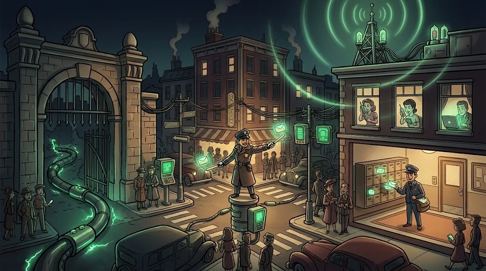

# İnternet aslında nedir?

> İnternet tek bir şey değil; **birbirine bağlanmış milyonlarca ağın** ortak adı.
> Senin yurt odan da bunlardan biri.

::cizgi[m05-01-sahne]

> 🕴️ **DOSYA: Dinleyici Nuri** · *Dinleyici*
>
> 
>
> **Tehdit:** Ortak Wi-Fi'de trafik dinleme, ARP/DNS sahteciliği, ortadaki adam. · [Gölge Ağ hikâyesi →](../../00-program/09-golge-ag.md)

::cizgi[nuri-acilis]

## Küçük ağ, büyük ağ

- **LAN** (yerel ağ) — Evin, yurdun, laboratuvarın. Cihazlar birbirini doğrudan görür.
- **WAN** (geniş alan ağı) — Şehirler ve ülkeler arası bağlantılar. İnternet en büyük WAN'dır.

## Cihazlar ve görevleri

| Cihaz | Benzetme | Görevi |
|---|---|---|
| **Modem** | Şehre açılan kapı | İnternet sağlayıcının hattını cihazların anlayacağı sinyale çevirir |
| **Router** (yönlendirici) | Kavşaktaki polis | Paketleri doğru ağa yönlendirir; ev ile internet arasında durur |
| **Switch** | Apartman posta kutuları | Aynı ağdaki cihazlar arasında doğru kişiye teslim eder |
| **Access point** | Telsiz verici | Kablosuz cihazları ağa bağlar |

Evdeki "modem" denen kutu çoğu zaman bunların **hepsini birden** yapar.

## Ethernet mi, Wi-Fi mı?

| | Ethernet (kablo) | Wi-Fi (kablosuz) |
|---|---|---|
| Hız ve kararlılık | Daha yüksek | Mesafe ve duvarlarla düşer |
| Güvenlik | Kabloya fiziksel erişim gerekir | Sinyal duvarın ötesine taşar |

Bu yüzden ortak Wi-Fi'de (kafe, yurt) dikkatli olmak gerekir — M08 ve Yol B'de ayrıntısı var.

## 🧪 Dene (3 dk)

Evindeki veya yurdundaki ağ cihazına bak: üzerinde hangi ışıklar var, kaç Ethernet girişi var?
Hangi görevleri (modem, router, switch, AP) yapıyor olabilir?

## ✅ Akılda kalsın

- İnternet = birbirine bağlı ağların ağı.
- Router ağlar arası yönlendirir, switch ağ içinde teslim eder.
- Wi-Fi sinyali duvarın ötesine taşar; ortak ağlarda dikkat.
