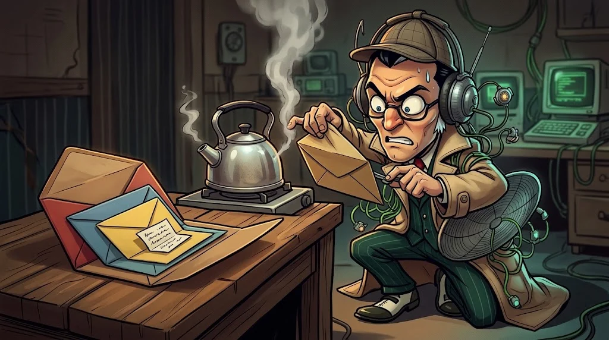

# Mektup zarf içinde zarf — OSI ve TCP/IP

> Bir mesaj ağda yolculuğa çıkmadan önce **kat kat paketlenir**.
> Her katman kendi zarfını ekler, karşı tarafta aynı katman o zarfı açar.

## Neden katman?

Her katman tek bir işe odaklanır. Wi-Fi'den Ethernet'e geçtiğinde web tarayıcının değişmesi gerekmez —
alt katman değişir, üstü aynı kalır.

## İki model yan yana

| OSI (7 katman) | TCP/IP (4 katman) | Örnek | Veri birimi |
|---|---|---|---|
| 7 Uygulama · 6 Sunum · 5 Oturum | **Uygulama** | HTTP, DNS, SSH | Mesaj |
| 4 Taşıma | **Taşıma** | TCP, UDP | Segment |
| 3 Ağ | **İnternet** | IP, ICMP | Paket |
| 2 Veri bağlantısı · 1 Fiziksel | **Ağ erişimi** | Ethernet, Wi-Fi | Çerçeve (frame), bit |

OSI öğretmek ve sorun anlatmak için kullanılır ("katman 2 sorunu"), TCP/IP ise gerçekte çalışan modeldir.

## Paketin yolculuğu

Bir paketin dizüstünden sunucuya giderken nasıl paketlendiğini ve hangi duraklardan geçtiğini izle:

::animasyon[packet-journey]

## Güvenlikçi için

Saldırılar da katmanlara göre konuşulur:
- **Katman 2:** ARP sahteciliği (aynı ağdakiler)
- **Katman 3–4:** IP sahteciliği, port taraması, SYN flood
- **Katman 7:** SQL injection, XSS, phishing

## 🧪 Dene (3 dk)

"Kafe Wi-Fi'sinde bir web sitesine giriş yapıyorum." cümlesindeki her teknolojiyi bir katmana yerleştir:
Wi-Fi, IP adresi, TCP, HTTPS.

## ✅ Akılda kalsın

- Her katman kendi zarfını ekler, karşıda aynı katman açar.
- TCP/IP gerçekte çalışan model; OSI ortak dil.
- Saldırılar ve savunmalar da katmanlara göre konuşulur.
