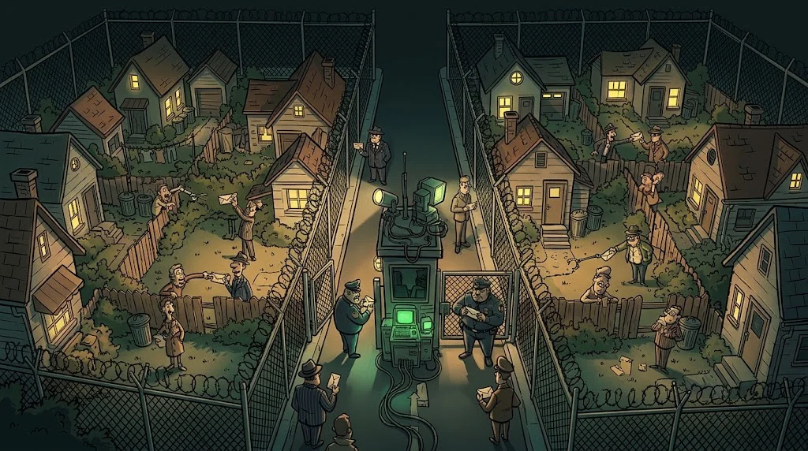

# IP, MAC ve 192.168: cihazların adresleri

> Bir paketin doğru cihaza ulaşması için iki adres gerekir:
> **hangi bina** (IP) ve **hangi daire** (MAC).

::cizgi[m05-03-sahne]

## Üç adres türü


| | Örnek | Ne işe yarar? |
|---|---|---|
| **IPv4** | `192.168.1.24` | Ağlar arası adres (4 sayı, 0–255) |
| **IPv6** | `2001:db8::24` | Yeni nesil, çok daha uzun adres |
| **MAC** | `3c:22:fb:1a:9e:07` | Ağ kartının yerel kimliği; sadece aynı ağda işe yarar |

Kendi adreslerini gör:

```bash
ip a          # Linux
ipconfig      # Windows (ayrıntı: ipconfig /all)
```

## Özel ve genel IP

Evdeki cihazların hepsi **özel** adresler kullanır; dışarıya tek bir **genel** adresle çıkarlar (NAT).

| Özel aralıklar | |
|---|---|
| `10.0.0.0 – 10.255.255.255` | Büyük kurumlar |
| `172.16.0.0 – 172.31.255.255` | Orta ölçekli ağlar |
| `192.168.0.0 – 192.168.255.255` | Evler, yurtlar |

Bir log'da `192.168.x.x` görüyorsan olay **içeride**, başka bir adres görüyorsan dışarıdan gelen bir bağlantı olabilir.

## Subnet: aynı mahalle mi?



`192.168.1.24/24` → ilk 24 bit (ilk üç sayı) **ağ adresi**, son sayı cihaz.
Yani `192.168.1.1` – `192.168.1.254` aynı ağdadır; `192.168.2.5` başka bir ağdır ve arada router gerekir.

| Gösterim | Maske | Ağdaki cihaz sayısı |
|---|---|---|
| `/24` | 255.255.255.0 | 254 |
| `/16` | 255.255.0.0 | 65.534 |

## 🧪 Dene (4 dk)

`ipconfig` veya `ip a` çalıştır. IP adresin özel mi? Varsayılan ağ geçidin (router) hangisi?
Telefonunun da aynı ağda olup olmadığını nasıl anlarsın?

## ✅ Akılda kalsın

- IP ağlar arası, MAC yerel ağ içi adrestir.
- 10.x, 172.16–31.x, 192.168.x özel adreslerdir.
- `/24` = ilk üç sayı aynıysa aynı ağ.
