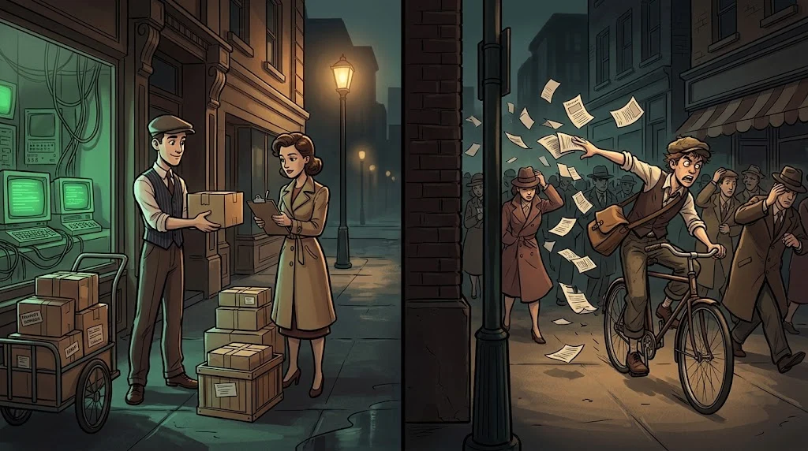
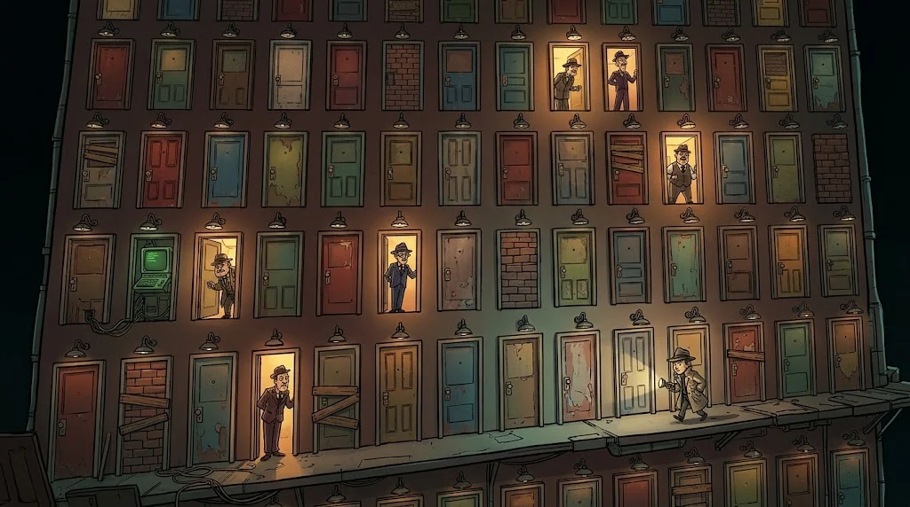

# TCP, UDP and ports

> An IP address brings you to the building; the **port** tells you which door to knock on.
> TCP and UDP, meanwhile, are how you talk through that door.

::cizgi[m05-04-sahne]

## TCP or UDP?



| | TCP | UDP |
|---|---|---|
| Analogy | A recorded-delivery letter | A postcard |
| Connection | Shakes hands first | Sends straight away |
| Lost packet | Resends it, keeps the order | Doesn't care |
| Where? | Web, email, SSH, files | DNS, video calls, games |

## The three-way handshake

Before TCP starts talking, the two sides agree: "are you ready?":

::animasyon[tcp-handshake]

## Ports you should know



| Port | Service | Note |
|---|---|---|
| 22 | SSH | Secure remote terminal |
| 53 | DNS | Name resolution (mostly UDP) |
| 80 | HTTP | Unencrypted web |
| 443 | HTTPS | Encrypted web |
| 25 / 587 | SMTP | Sending email |
| 3389 | RDP | Windows remote desktop — should never be open to the internet |
| 3306 / 5432 | MySQL / PostgreSQL | Database — should never be open to the internet |

A port being **open** means a service is listening there.
Every unnecessary open port is a door an attacker can try.

## Ports listening on your own computer

```bash
ss -tuln          # Linux
netstat -ano      # Windows
```

## 🧪 Try it (3 min)

Run `ss -tuln` (or `netstat -ano`). Which ports are in the `LISTEN` state? Do you recognise any?

## ✅ Remember

- TCP is reliable and ordered; UDP is fast and lean.
- TCP starts every connection with SYN → SYN-ACK → ACK.
- An unnecessary open port is an unnecessary door.
