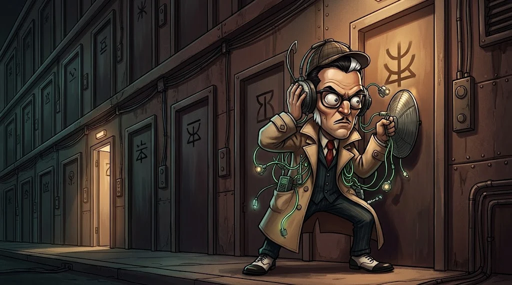

# TCP, UDP ve portlar

> IP adresi seni binaya getirir; **port** hangi kapıyı çalacağını söyler.
> TCP ve UDP ise kapıdan nasıl konuşacağını.



## TCP mi, UDP mi?

| | TCP | UDP |
|---|---|---|
| Benzetme | İadeli taahhütlü mektup | Kartpostal |
| Bağlantı | Önce el sıkışır | Doğrudan gönderir |
| Kayıp paket | Yeniden gönderir, sırayı korur | Umursamaz |
| Nerede? | Web, e-posta, SSH, dosya | DNS, video görüşme, oyun |

## Üçlü el sıkışma

TCP konuşmaya başlamadan önce iki taraf "hazır mısın?" diye sözleşir:

::animasyon[tcp-handshake]

## Bilmen gereken portlar

| Port | Servis | Not |
|---|---|---|
| 22 | SSH | Uzaktan güvenli terminal |
| 53 | DNS | Ad çözümleme (UDP ağırlıklı) |
| 80 | HTTP | Şifresiz web |
| 443 | HTTPS | Şifreli web |
| 25 / 587 | SMTP | E-posta gönderme |
| 3389 | RDP | Windows uzak masaüstü — internete açık olmamalı |
| 3306 / 5432 | MySQL / PostgreSQL | Veritabanı — asla internete açık olmamalı |

Bir portun **açık** olması, orada bir servisin dinlediği anlamına gelir.
Gereksiz her açık port, saldırganın deneyebileceği bir kapıdır.

## Kendi bilgisayarında dinleyen portlar

```bash
ss -tuln          # Linux
netstat -ano      # Windows
```

## 🧪 Dene (3 dk)

`ss -tuln` (veya `netstat -ano`) çalıştır. Hangi portlar `LISTEN` durumunda? Tanıdığın var mı?

## ✅ Akılda kalsın

- TCP güvenilir ve sıralı, UDP hızlı ve yalın.
- TCP her bağlantıyı SYN → SYN-ACK → ACK ile başlatır.
- Gereksiz açık port, gereksiz bir kapıdır.
