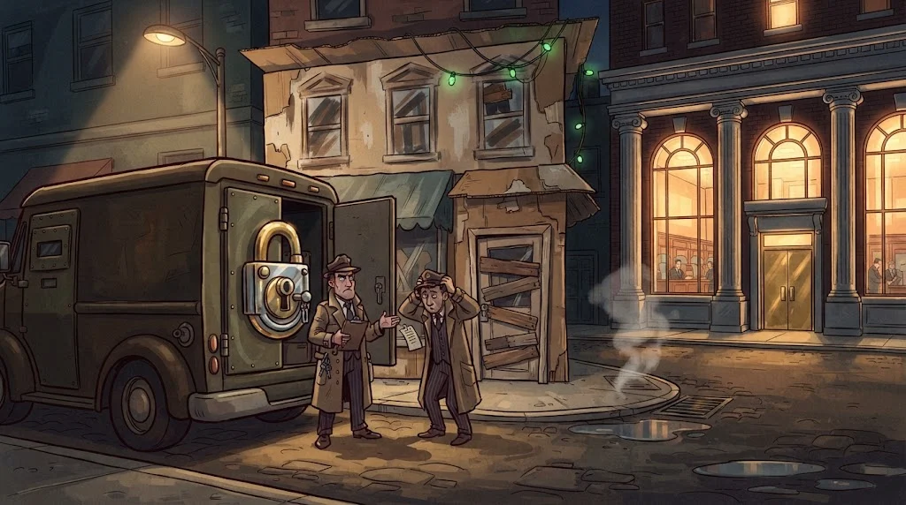

# What does the padlock in the address bar tell you?

> 🔒 doesn't mean "this site is safe". It means "the path between you and this site is encrypted and
> this site really is the domain name it claims". That's a big difference.

::cizgi[m05-06-sahne]

## HTTPS = HTTP + TLS

TLS provides three things:

1. **Privacy** — Nobody on the path (café Wi-Fi, the network administrator) can read the content.
2. **Integrity** — Nobody on the path can change the content.
3. **Identity** — The server you're connecting to really is `banka.example`; the certificate proves it.

How do the browser and the server agree on a key that an eavesdropper can't work out?

::animasyon[tls-handshake]

## Learn to look at the certificate

- **Issued to:** Is the domain name the same as the one in the address bar?
- **Issued by:** Is it a recognised certificate authority (CA)?
- **Validity:** Has the date passed?

The browser already checks these and shows **a big red warning** if something's wrong.
Clicking through that warning with "continue" throws away the whole point of the padlock.

## What the padlock doesn't guarantee

A scammer can get a valid certificate for `kku-burs-onay.example` too.
The padlock says **"you're connected securely to the right address"**; it doesn't say **"this address is honest"**. You still have to read the domain name yourself.

## 🧪 Try it (3 min)

On your school's or bank's site, click the padlock icon and open the certificate.
Who issued it? When does it expire?

## ✅ Remember

- TLS: privacy, integrity, identity.
- The padlock says the address is right, not that it's honest.
- Never get past a certificate warning with "continue anyway".
