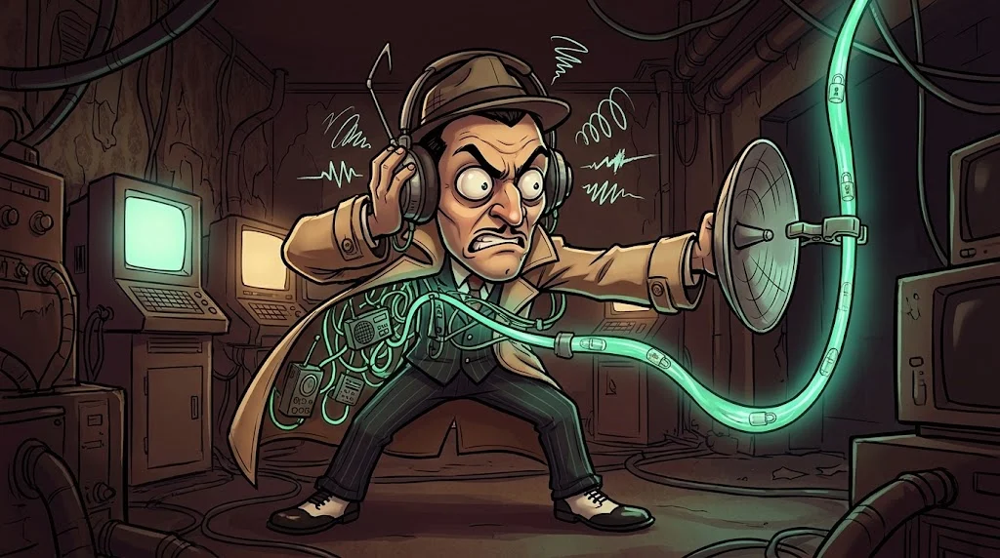

# Adres çubuğundaki kilit ne anlatıyor?

> 🔒 kilit "bu site güvenli" demek **değildir**. "Bu siteyle aranızdaki yol şifreli ve
> bu site gerçekten iddia ettiği alan adı" demektir. Fark büyük.

## HTTPS = HTTP + TLS

TLS üç şey sağlar:

1. **Gizlilik** — Yoldaki kimse (kafe Wi-Fi'si, ağ yöneticisi) içeriği okuyamaz.
2. **Bütünlük** — Yolda kimse içeriği değiştiremez.
3. **Kimlik** — Bağlandığın sunucu gerçekten `banka.example`'dır; sertifika bunu kanıtlar.

Tarayıcı ile sunucu, dinleyen birinin çözemeyeceği bir anahtarda nasıl anlaşır?

::animasyon[tls-handshake]

## Sertifikaya bakmayı öğren

- **Verilen:** Alan adı adres çubuğundakiyle aynı mı?
- **Veren:** Tanınmış bir sertifika otoritesi (CA) mi?
- **Geçerlilik:** Tarihi geçmiş mi?

Tarayıcı bunları zaten kontrol eder ve sorun varsa **büyük kırmızı bir uyarı** gösterir.
O uyarıyı "devam et" diyerek geçmek, kilidin bütün anlamını çöpe atmaktır.

## Kilit neyi garanti etmez?

Bir dolandırıcı da `kku-burs-onay.example` için geçerli bir sertifika alabilir.
Kilit **"doğru adrese şifreli bağlandın"** der; **"bu adres dürüst"** demez. Alan adını yine sen okursun.

## 🧪 Dene (3 dk)

Okulunun veya bankanın sitesinde kilit simgesine tıkla ve sertifikayı aç.
Veren kim? Geçerlilik ne zaman bitiyor?

## ✅ Akılda kalsın

- TLS: gizlilik, bütünlük, kimlik.
- Kilit adresin doğru olduğunu söyler, dürüst olduğunu değil.
- Sertifika uyarısını asla "yine de devam et" ile geçme.
