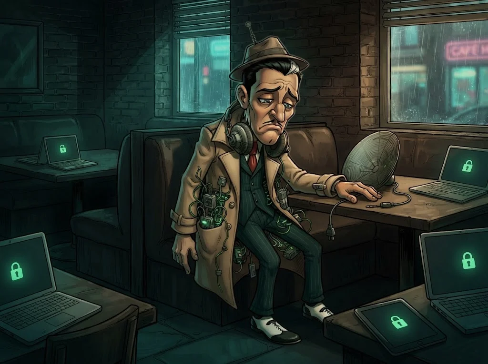

# M05 Quiz: İnternet ve ağlar

8 soru · geçme notu %70.

> 🔒 **DOSYA KAPANDI: Dinleyici Nuri** · *quiz'i %70 ile geçince*
>
> 
>
> Nuri'nin cihazı söküldü; trafik artık şifreli. Ama dinlediği son paket fırının kendi sunucusuna gidiyordu. Fırının sahibi kuzeni: Çerezci Celal.
>
> ➡️ *Sıradaki dosya: **Çerezci Celal** (M06)*
