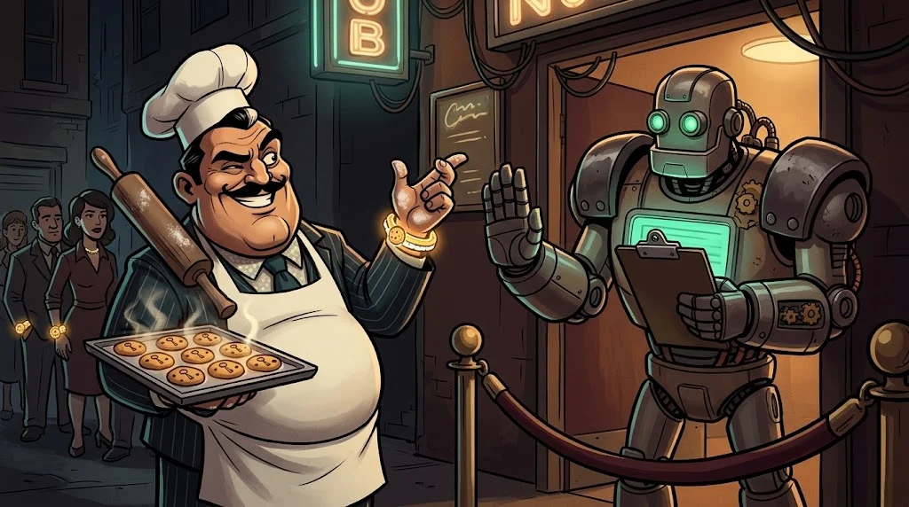

# Sunucu seni nasıl hatırlıyor? Cookie, oturum, token

> HTTP unutkandır: her istekte seni ilk kez görür. Seni hatırlatan şey tarayıcının
> her istekte gösterdiği küçük bir **bilet**tir.

## Üç kavram

- **Cookie (çerez)** — Sunucunun tarayıcına bıraktığı, her istekte geri gelen küçük not.
- **Session (oturum)** — Sunucunun "bu bilet şu kişiye ait" diye tuttuğu kayıt. Çerezde sadece rastgele bir kimlik durur.
- **Token** — Kendi içinde bilgi taşıyan imzalı bilet (ör. JWT). Genelde API'lerde kullanılır.

Bilet kimin elindeyse sunucu onu **sen** sanır. Bu yüzden oturum çerezi bir paroladan farksızdır.

## Giriş akışı

::animasyon[authentication]

## Çerezin güvenlik ayarları

| Ayar | Koruduğu şey |
|---|---|
| `HttpOnly` | JavaScript çerezi okuyamaz → XSS ile çalınması zorlaşır |
| `Secure` | Sadece HTTPS ile gönderilir |
| `SameSite` | Başka sitelerden gelen isteklere eklenmez → CSRF'e karşı |

## İki farklı soru

| | Kimlik doğrulama (authentication) | Yetkilendirme (authorization) |
|---|---|---|
| Soru | **Sen kimsin?** | **Bunu yapmaya iznin var mı?** |
| Örnek | Parola + MFA ile giriş | Öğrenci başkasının notunu göremez |
| Hata olursa | Başkası senin yerine girer | Giriş yapan herkes her şeyi görür |

Web açıklarının en yaygınlarından biri ikincisidir: giriş doğru, **yetki kontrolü eksik**.
URL'deki `/notlar/1001`'i `/notlar/1002` yaparak başkasının notunu görmek gibi (Yol A: IDOR).

## 🧪 Dene (3 dk)

Kendi tarayıcında bir sitenin çerezlerine bak. Oturum çerezinde `HttpOnly` ve `Secure` işaretli mi?
⚠️ Çerez **değerlerini** kimseyle paylaşma, ekran görüntüsüne alma.

## ✅ Akılda kalsın

- Oturum çerezi = parola değerinde bilet.
- HttpOnly, Secure, SameSite çerezi korur.
- Kimlik doğrulama "kimsin?", yetkilendirme "iznin var mı?" sorusudur.
