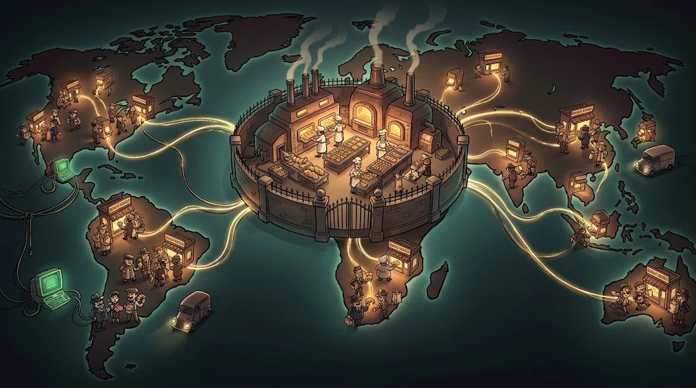

# The cloud and the CDN — where is the server now?

> Today most applications' servers don't run in a basement; they run in **someone else's data centre**.

::cizgi[m06-05-sahne]

## The cloud: rent it, use it

| Model | What do you manage? | Example |
|---|---|---|
| **IaaS** | The operating system and above | A virtual server in the cloud |
| **PaaS** | Only your application | Application hosting platforms |
| **SaaS** | Nothing, you just use it | Email, office applications |

## Shared responsibility

The cloud provider is responsible for **the security of the cloud** (buildings, hardware);
you are responsible for **the security of what's in the cloud** (your settings, your data, your access permissions).

A significant share of real data leaks comes not from the cloud being "broken"
but from misconfigurations such as **a storage area left open to everyone**.

## CDN: bringing the content closer to you

A **CDN** (content delivery network) copies the site's images and files to servers all over
the world. You fetch them from the nearest one → the page opens quickly.

Its contribution to security:
- It hides the real server and reduces the load reaching it.
- It can absorb large traffic attacks (DDoS).
- It often also provides a web application firewall (WAF).

## 🧪 Try it (3 min)

Use `nslookup` to look up the address of a big news site. Could the IPs that come back belong to that company,
or to a CDN? (Hint: you can find who owns an IP with a WHOIS query — M09.)

## ✅ Remember

- IaaS → PaaS → SaaS: the higher you go, the less you manage.
- In the cloud, misconfiguration is the most common cause of leaks.
- A CDN moves content closer and protects the real server.
