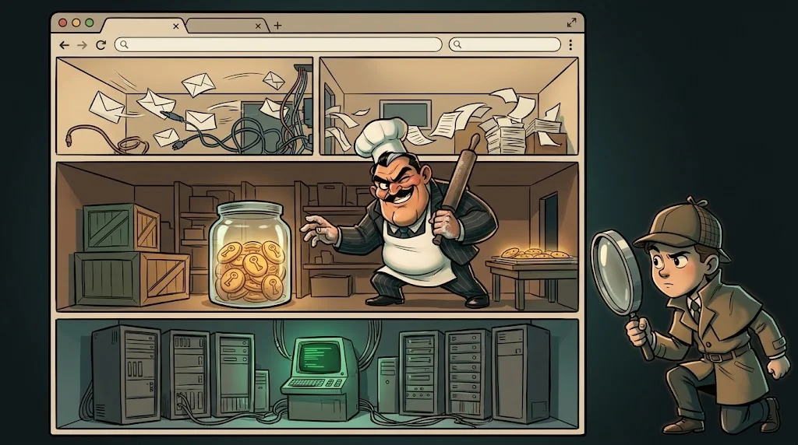

# Uygulama: Tarayıcının arkasında ne var?

> Laboratuvardaki eğitim uygulamasını hiç dokunmadan, yalnızca **izleyerek** tanı.
> Bu, her web güvenliği testinin ilk adımıdır: keşif.

## Ortam

Ördek Lab'deki eğitim uygulaması (laboratuvar adresi eğitmen tarafından verilir).
Test hesabıyla giriş yap. **Bu görevde hiçbir isteği değiştirmiyorsun** — sadece gözlemliyorsun.

## Görev

F12 → **Network** açıkken uygulamada gezin ve şu tabloyu doldur:

| # | Soru | Cevabın |
|---|---|---|
| 1 | Giriş yaparken giden istek hangi **yöntem** ve **adres**? | |
| 2 | Giriş başarılı olunca sunucu hangi **çerezi** bıraktı? HttpOnly/Secure var mı? | |
| 3 | Sayfadaki verileri getiren bir **API isteği** bul. Adresi ve döndürdüğü JSON alanları? | |
| 4 | Yanıtlarda hangi **güvenlik başlıkları** var, hangileri eksik? | |
| 5 | Hangi istekler **4xx/5xx** döndü? Neden olabilir? | |
| 6 | Sayfada çalışan JavaScript dosyalarının kaç tanesi **başka bir alan adından** geliyor? | |

## Teslim

Tabloyu ve bir paragraf yorum: *"Bu uygulamada bir saldırgan olsaydım, ilk nereye bakardım ve neden?"*

Değerlendirme notu
Doğru cevap tek değildir. İyi yorumlar şunlara dikkat çeker: kimlik numarası içeren API adresleri (yetkilendirme kontrolü), eksik güvenlik başlıkları, HttpOnly olmayan çerezler, ayrıntılı hata mesajları.

## ✅ Akılda kalsın

- Keşif = dokunmadan izlemek; her testin ilk adımı.
- Network sekmesi bir uygulamanın bütün konuşmalarını gösterir.
- Kimlik numarası taşıyan API adresleri yetkilendirme sorusunu doğurur.
