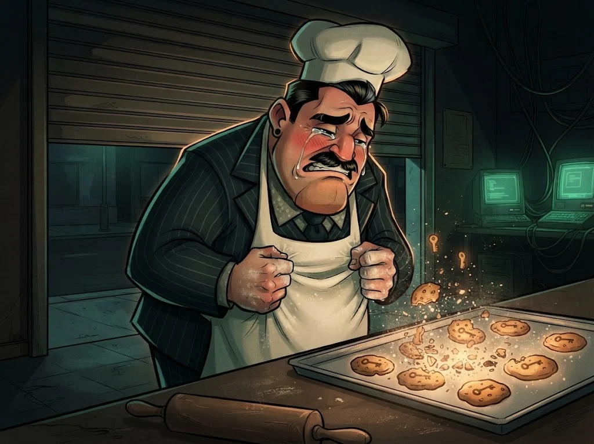

# M06 Quiz: Web teknolojileri

7 soru · geçme notu %70.

> 🔒 **DOSYA KAPANDI: Çerezci Celal** · *quiz'i %70 ile geçince*
>
> 
>
> Çerez tezgâhı kapandı; oturumlar güvende. Fırının arka odasında bir kablo yığını duruyor — iplerin hepsi tek bir kuklacıya uzanıyor.
>
> ➡️ *Sıradaki dosya: **Kuklacı Orhan** (M07)*
