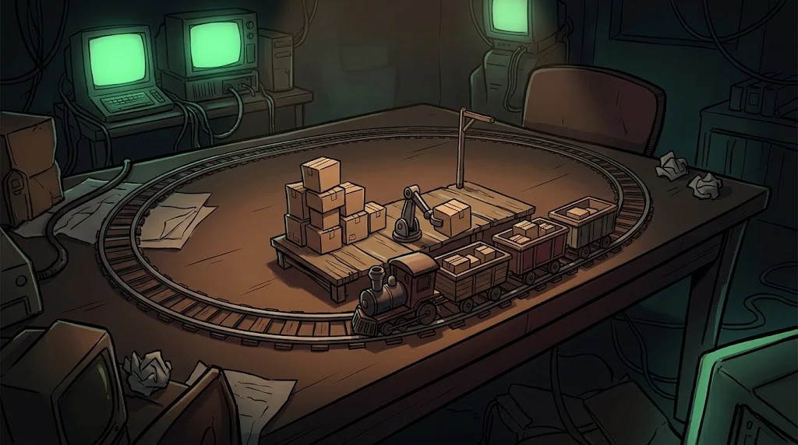

# Decide, repeat

> Programs get their power from two things: **making decisions** (if) and **repeating without getting bored** (for/while).

::cizgi[m07-02-sahne]

## Conditions


```python
deneme = 7
if deneme >= 10:
    print("Hesap kilitlensin")
elif deneme >= 5:
    print("Uyarı: şüpheli")
else:
    print("Normal")
```

In Python **indentation** (4 spaces) defines the block; there are no brackets.

## Lists and dictionaries

```python
portlar = [22, 80, 443]               # list: ordered
portlar.append(3306)

servis = {22: "SSH", 80: "HTTP", 443: "HTTPS"}   # dictionary: key → value
print(servis[443])                    # HTTPS
print(servis.get(3306, "bilinmiyor")) # default if the key is missing
```

## Loops



```python
for p in portlar:
    print(p, servis.get(p, "?"))

sayac = 0
while sayac < 3:
    sayac += 1
```

## Functions

If you're writing the same job three times, it's time for a function:

```python
def risk_seviyesi(deneme: int) -> str:
    if deneme >= 10:
        return "yüksek"
    if deneme >= 5:
        return "orta"
    return "düşük"

for ip, n in {"203.0.113.66": 58, "198.51.100.23": 3}.items():
    print(ip, risk_seviyesi(n))
```

## 🧪 Try it (5 min)

Keep the quiz scores of 4 students in a dictionary. Write a loop that prints "passed" for 70 and above, and "again" below that.

## ✅ Remember

- `if/elif/else` decides; indentation defines the block.
- A list holds ordered data, a dictionary holds key → value.
- Turn repeated logic into a function.
