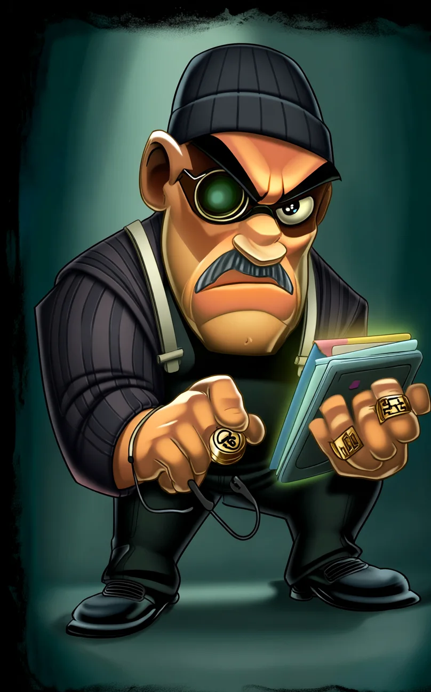
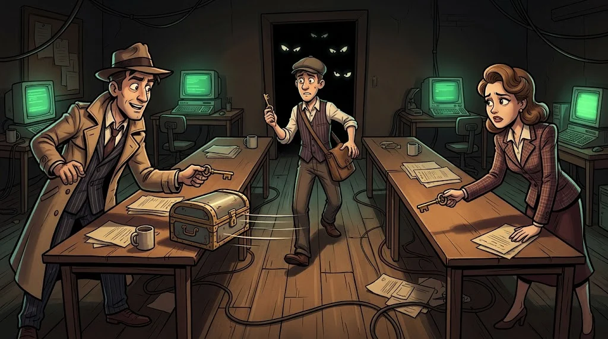
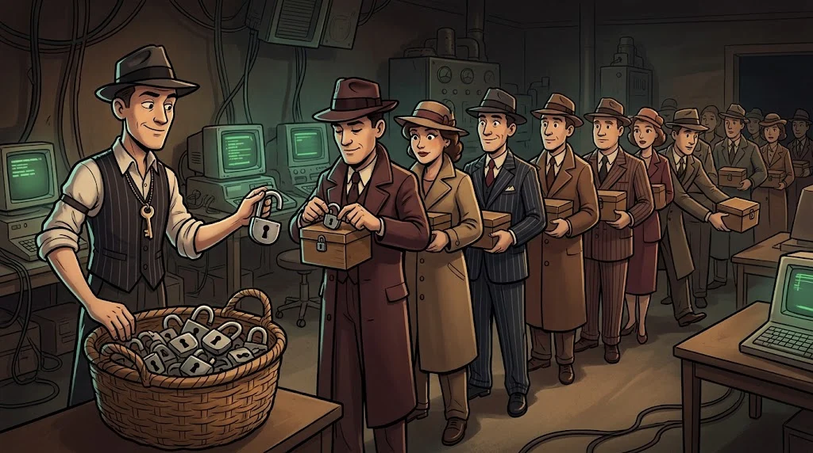

# Bir sırrı herkesin önünde nasıl saklarsın?

> İnternetteki her mesaj, onlarca bilgisayarın üzerinden geçer.
> **Şifreleme**, mesajı görenlerin onu okuyamamasını sağlar.

::cizgi[m08-01-sahne]

> 🕴️ **DOSYA: Kasa Kıran Kadir** · *Kasa Hırsızı*
>
> 
>
> **Tehdit:** Parola kırma, zayıf hash'ler, tuzsuz parolalar, sızmış parola listeleri. · [Gölge Ağ hikâyesi →](../../00-program/09-golge-ag.md)

::cizgi[kadir-acilis]

## İki taraf

- **Kriptografi** — Bilgiyi koruyan yöntemleri tasarlamak.
- **Kriptoanaliz** — Bu yöntemleri kırmaya çalışmak (zayıflıklarını bulmak).

Kural: **Kendi şifreleme algoritmanı icat etme.** Yıllarca analiz edilmiş standartları kullan (AES, RSA, ECC).

## Simetrik şifreleme: tek anahtar



Kilitleyen ve açan **aynı** anahtar.

```text
"Merhaba" + anahtar K  →  şifreleme  →  "x9#Lq2…"
"x9#Lq2…" + anahtar K  →  çözme      →  "Merhaba"
```

- ✅ Çok hızlı (diskler, dosyalar, büyük veriler)
- ❌ Anahtarı karşı tarafa **güvenle** nasıl ulaştıracaksın?
- Örnek: **AES**

## Asimetrik şifreleme: anahtar çifti



- **Açık anahtar** (public) — herkese verilir; mesajı **kilitler**.
- **Özel anahtar** (private) — yalnızca sende; kilidi **açar**.

Herkese açık asma kilit dağıtıp anahtarını kendinde tutmak gibi.

- ✅ Anahtar paylaşma sorunu çözülür
- ❌ Yavaş
- Örnek: **RSA**, **ECC**

## Gerçek hayatta ikisi birlikte

HTTPS'te önce asimetrik yöntemle ortak bir anahtarda anlaşılır, sonra veri hızlı simetrik şifreleme ile gider (M05-06).

## 🧪 Dene (3 dk)

Hangisi uygun? (a) laptop diskini şifrelemek, (b) hiç tanışmadığın biriyle internetten ilk kez gizli konuşmaya başlamak.

<details><summary>Cevap</summary>(a) Simetrik — tek kişi, çok veri. (b) Önce asimetrik ile anahtar anlaşması, sonra simetrik.</details>

## ✅ Akılda kalsın

- Kendi algoritmanı icat etme; standartları kullan.
- Simetrik: tek anahtar, hızlı. Asimetrik: anahtar çifti, paylaşımı kolay.
- Gerçek sistemler ikisini birlikte kullanır.
