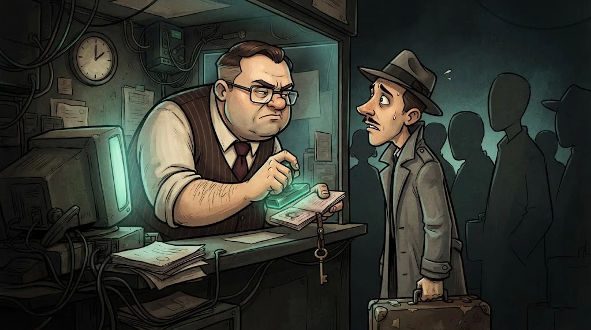

# Dijital imza ve sertifika

> Şifreleme "kimse okuyamasın" der. İmza ise "**bunu gerçekten ben gönderdim ve kimse değiştirmedi**" der.

::cizgi[m08-03-sahne]

## Dijital imza nasıl çalışır?


1. Gönderen belgenin **hash**'ini alır.
2. Hash'i kendi **özel anahtarıyla** imzalar.
3. Alıcı, göndericinin **açık anahtarıyla** imzayı doğrular ve kendi hesapladığı hash ile karşılaştırır.

Sonuç:
- ✅ **Kimlik** — İmza ancak o özel anahtarla atılabilir.
- ✅ **Bütünlük** — Belgede tek harf değişse hash tutmaz.
- ✅ **İnkâr edilemezlik** — "Ben göndermedim" denemez.

Nerede? Yazılım güncellemeleri, e-imzalı belgeler, Git commit'leri, TLS.

## Sertifika: "Bu açık anahtar gerçekten kime ait?"



Bir saldırgan da "ben bankayım" diyen bir açık anahtar üretebilir. Çözüm: **güvenilir bir üçüncü taraf** bunu doğrulayıp imzalar.

- **Sertifika** = alan adı + açık anahtar + bir **Sertifika Otoritesinin (CA)** imzası
- **PKI** (Açık Anahtar Altyapısı) = CA'lar, sertifikalar ve doğrulama kurallarının tamamı

## Güven zinciri

```text
Kök CA (tarayıcında/işletim sisteminde önceden yüklü)
   └── Ara CA (kök tarafından imzalanmış)
         └── kuzeykiyi.edu.example sertifikası (ara CA tarafından imzalanmış)
```

Tarayıcı zinciri yukarı doğru takip eder; köke ulaşamazsa uyarı verir.
Bu doğrulamanın TLS el sıkışmasında nerede olduğunu gör:

::animasyon[tls-handshake]

## 🧪 Dene (3 dk)

Bir sitenin sertifikasını aç (M05-06) ve **Sertifika yolu / Certificate Hierarchy** sekmesine bak.
Zincirde kaç halka var? Kök CA'nın adı ne?

## ✅ Akılda kalsın

- İmza: özel anahtarla atılır, açık anahtarla doğrulanır.
- İmza kimlik, bütünlük ve inkâr edilemezlik sağlar.
- Sertifika açık anahtarı bir kimliğe bağlar; güven, kök CA'ya kadar uzanan zincirle kurulur.
