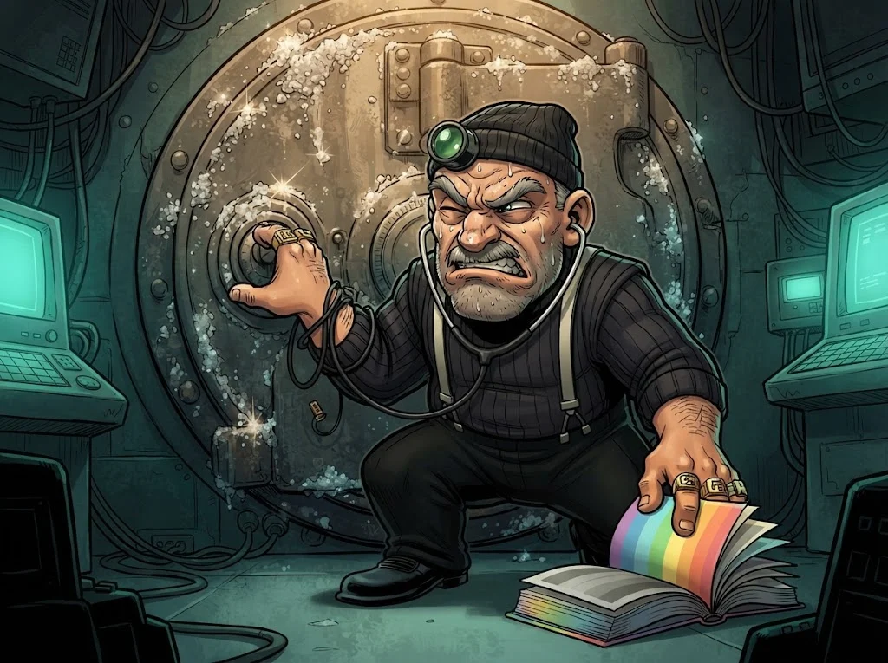

# M08 Quiz: Kriptografi ve dijital kimlik

7 soru · geçme notu %70.

> 🔒 **DOSYA KAPANDI: Kasa Kıran Kadir** · *quiz'i %70 ile geçince*
>
> 
>
> Kadir'in açamadığı tek kasa güçlü, tuzlu parolalardı. Teslim olmadan önce tek bir isim veriyor: "Ben sadece açarım. Kime açtığımı Mine Hanım bilir."
>
> ➡️ *Sıradaki dosya: **Maskeli Mine** (M09)*
