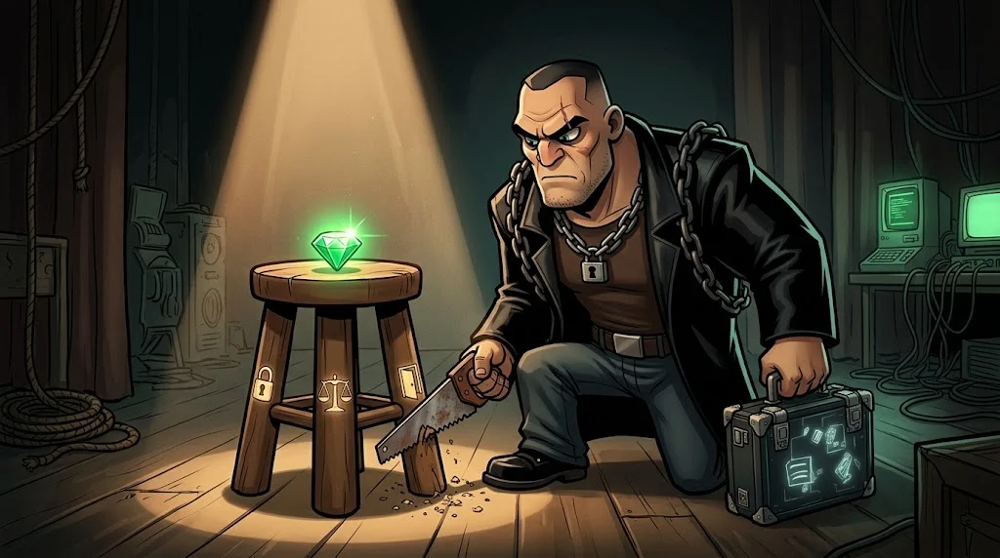

# Tehdit, zafiyet, risk — ve CIA üçlüsü

> Bu üç kelime çoğu zaman karıştırılır. Bir güvenlikçi ise onları
> **ayrı ayrı** düşünür, çünkü her biri farklı bir önlem ister.

> 🕴️ **DOSYA: Fidyeci Ferhat** · *Fidye Patronu*
>
> 
>
> 📼 **Bölüm 10 — Fidye.** Şehrin hastanesi sabaha karşı kilitlendi; bütün ekranlarda tek bir asma kilit. Fidyeci Ferhat'ın zinciri yedi halkalı: keşiften sızmaya, sızmadan şifrelemeye. Senin işin tek bir halkayı kırmak.
>
> **Tehdit:** Fidye yazılımı, zararlı yazılım, saldırı zinciri (kill chain), DDoS. · [Gölge Ağ hikâyesi →](../../00-program/09-golge-ag.md)

## Üç kavram, bir örnek

Yurt odanın kapısı:

| Kavram | Tanım | Örnek |
|---|---|---|
| **Varlık** | Korumak istediğin şey | Laptopun |
| **Zafiyet** (vulnerability) | Zayıf nokta | Kapının kilidi bozuk |
| **Tehdit** (threat) | Zayıflığı kullanabilecek kişi/olay | Koridordan geçen biri |
| **Risk** | Olasılık × etki | Kilit bozuk + kalabalık koridor + pahalı laptop = **yüksek** |

Risk sıfırlanamaz, **yönetilir**: düzelt (kilidi tamir et), azalt (laptopu dolaba kilitle), devret (sigorta), kabul et.

## CIA üçlüsü

Güvenliğin üç hedefi — biri eksilirse tabure devrilir:

| İlke | Soru | İhlal örneği |
|---|---|---|
| **Gizlilik** (Confidentiality) | Sadece yetkili kişi mi görüyor? | Not listesinin sızması |
| **Bütünlük** (Integrity) | Veri doğru ve değiştirilmemiş mi? | Notların izinsiz değiştirilmesi |
| **Erişilebilirlik** (Availability) | İhtiyaç anında ulaşılabiliyor mu? | Kayıt haftasında portalın çökmesi |

Her saldırıyı "CIA'nın hangisini bozuyor?" diye sınıflandırabilirsin.

## 🧪 Dene (3 dk)

Üç olayı CIA ilkelerinden biriyle eşle:
1. Fidye yazılımı dosyaları şifreledi.
2. Bir öğrenci başkasının ödevini görebildi.
3. Bir saldırgan banka hesap numarasını faturada değiştirdi.

Cevap
1 → Erişilebilirlik · 2 → Gizlilik · 3 → Bütünlük

## ✅ Akılda kalsın

- Zafiyet zayıf nokta, tehdit onu kullanabilecek olan, risk ikisinin buluşması.
- Risk yönetilir: düzelt, azalt, devret, kabul et.
- CIA: gizlilik, bütünlük, erişilebilirlik.
