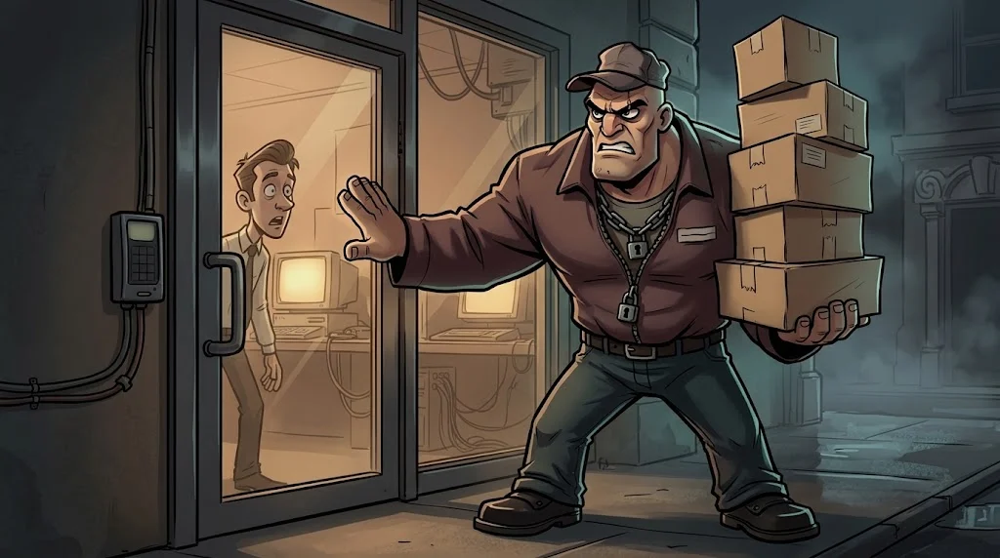

# İnsanı hacklemek

> Bir sistemi kırmak zor olabilir; **birini ikna etmek** çoğu zaman daha kolaydır.
> Sosyal mühendislik teknolojiyi değil, insan psikolojisini hedefler.

## Altı tetikleyici

| Tetikleyici | Örnek cümle |
|---|---|
| **Otorite** | "Rektörlükten arıyorum." |
| **Aciliyet** | "10 dakika içinde onaylamazsanız hesabınız silinir." |
| **Korku** | "Hesabınızdan şüpheli giriş yapıldı!" |
| **Merak** | "Sınav sorularının sızdığı dosya ekte." |
| **Yardımseverlik** | "Kartımı unuttum, kapıyı tutar mısın?" |
| **Açgözlülük** | "Hediye çeki kazandınız." |

## Phishing ailesi

- **Phishing** — Toplu, sahte e-posta.
- **Spear phishing** — Hedefe özel hazırlanmış (adını, bölümünü bilir).
- **Smishing / vishing** — SMS / telefonla.
- **Quishing** — Sahte QR kod (afişin üstüne yapıştırılmış).

Bir phishing saldırısının baştan sona yaşam döngüsü:

::animasyon[phishing]

## Savunma: "dur, doğrula, bildir"

1. **Dur** — Aciliyet hissediyorsan bu bir işarettir.
2. **Doğrula** — Bildiğin bir kanaldan (resmî site, bilinen telefon) teyit et; mesajdaki bağlantıyı/numarayı kullanma.
3. **Bildir** — Tıkladıysan bile utanma, hemen bildir; erken bildirim zararı küçültür.

## 🧪 Dene (3 dk)

Son bir haftada aldığın bir reklam ya da bildirimde bu altı tetikleyiciden hangilerini görebiliyorsun?

## ✅ Akılda kalsın

- Sosyal mühendislik teknolojiyi değil insanı hedefler.
- Otorite, aciliyet, korku, merak, yardımseverlik, açgözlülük.
- Dur, bağımsız kanaldan doğrula, bildir.
