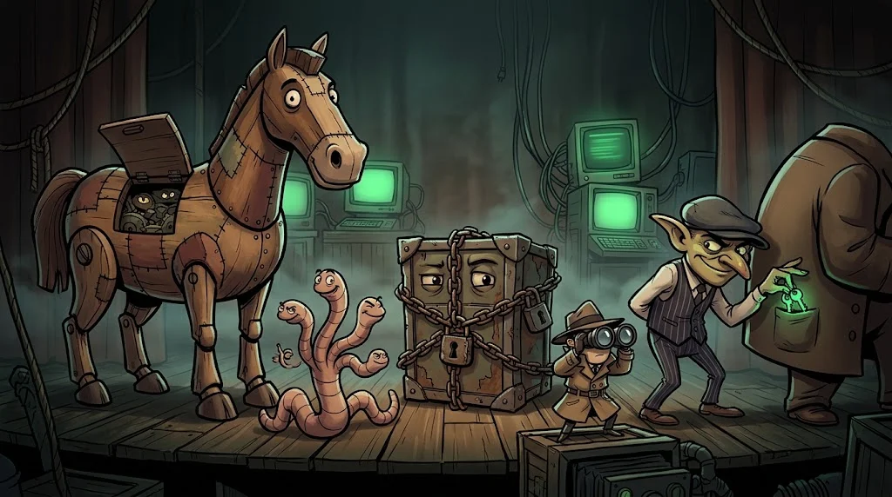
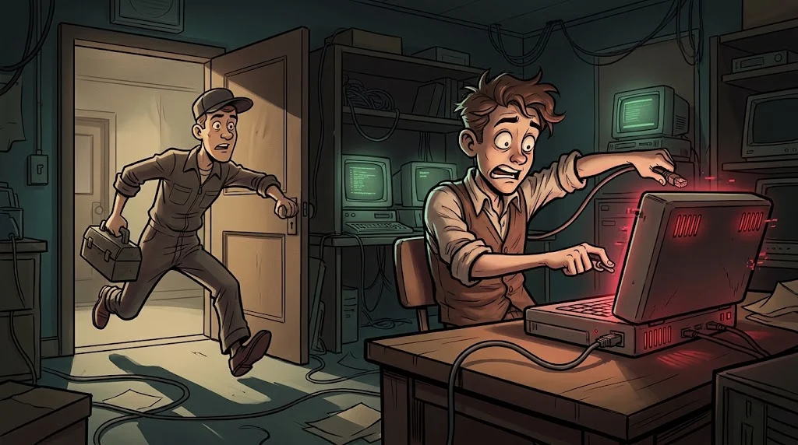

# The malware family

> We call them all "viruses", but the family is crowded. Every member has a different **route of infection** and a different **purpose**.

::cizgi[m10-04-sahne]

## Family members

| Type | How does it spread? | What does it do? |
|---|---|---|
| **Trojan** | Inside a program that looks useful (crack, fake update) | Opens a backdoor, steals data |
| **Worm** | **On its own**, through flaws in the network | Multiplies fast, fills the network |
| **Ransomware** | A phishing attachment, exposed RDP, a weak password | Encrypts files, demands a ransom |
| **Spyware** | Fake applications, abuse of permissions | Collects location, messages, screen information |
| **Infostealer** | Crack/cheat programs | Steals the passwords and session cookies in your browser |

## The most common routes of infection

1. Email attachments and links (see M10-03)
2. "Free" cracks, cheats and pirated software
3. Flaws in software that hasn't been updated
4. Fake browser extensions and applications
5. USB sticks you don't recognise

## The best insurance against ransomware

Paying the ransom does **not guarantee** you get your files back. The real remedy:
an **offline, tested backup** (the 3-2-1 rule in M03-05).

## What if you're infected?

- **Disconnect** the device from the network (turn off Wi-Fi, pull the cable).
- Don't restart it; to preserve the evidence and the chance of recovery, tell an **expert** or the IT department.
- Change the passwords of your important accounts from another device.

## 🧪 Try it (3 min)

List the **browser extensions** on your computer. Are there any you don't recognise or don't use? Remove them.

## ✅ Remember

- A trojan tricks you, a worm spreads itself, ransomware encrypts.
- Cracks and cheat programs are among the most common routes of infection.
- The best remedy against ransomware is an offline backup.
