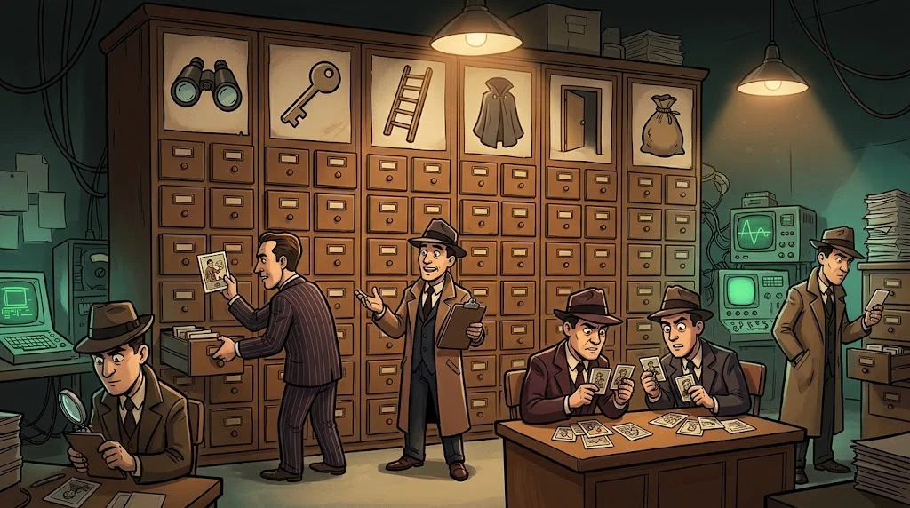

# The stages of an attack

> Attacks don't happen in a single move; they advance stage by stage like a **chain**.
> The good news: breaking the chain **at any link** stops the attack.

::cizgi[m10-07-sahne]

## Cyber Kill Chain (7 links)

| # | Stage | Example | Where is it broken? |
|---|---|---|---|
| 1 | **Reconnaissance** | Finding the club administrators' emails | Reducing public information |
| 2 | **Weaponisation** | Preparing a document with a malicious attachment | — |
| 3 | **Delivery** | A phishing email | Email filter, awareness |
| 4 | **Exploitation** | The macro in the document running | Updates, blocking macros |
| 5 | **Installation** | Settling into startup for persistence | EDR, least privilege |
| 6 | **Command and control** | A connection to the attacker's server | Egress traffic filtering, DNS monitoring |
| 7 | **Actions on objectives** | Stealing data, encryption | Segmentation, backup, DLP |

## MITRE ATT&CK

The Kill Chain says "at which stage?"; **ATT&CK** says "**exactly how?**"
It is a public knowledge base that sorts hundreds of techniques observed in real attacks by tactic.

Example: *T1059 — Command and Scripting Interpreter* (abuse of a command interpreter).
It provides a common language: saying "this alert is technique T1110 (Brute Force)" tells all teams the same thing.

## Detection: the heart of defence

No measure is 100%. That is why **noticing** matters as much as preventing.
The journey of an alert from the endpoint to the SOC and to the response:

::animasyon[soc-alert]

## 🧪 Try it (4 min)

Place the `auth.log` incident from M07 into the Kill Chain. Which stages are visible in the log, and which are not?

## ✅ Remember

- An attack is a chain; breaking one link is enough.
- The Kill Chain tells you the stage, ATT&CK the technique.
- Prevention isn't enough; detection and response are needed too.
