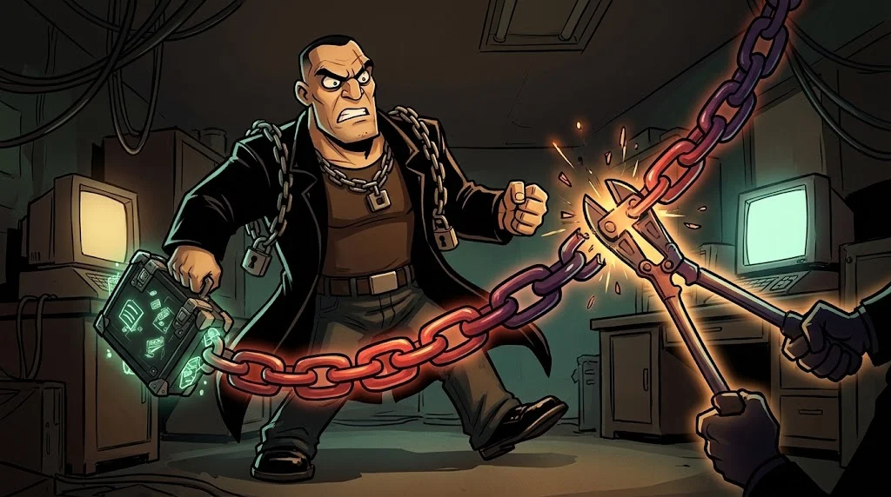

# Bir saldırının aşamaları

> Saldırılar tek hamlede olmaz; bir **zincir** gibi aşama aşama ilerler.
> İyi haber: zinciri **herhangi bir halkada** kırmak saldırıyı durdurur.

## Cyber Kill Chain (7 halka)

| # | Aşama | Örnek | Nerede kırılır? |
|---|---|---|---|
| 1 | **Keşif** | Kulüp yöneticilerinin e-postalarını bulmak | Açık bilgiyi azaltmak |
| 2 | **Silahlanma** | Zararlı ekli belge hazırlamak | — |
| 3 | **Teslimat** | Phishing e-postası | E-posta filtresi, farkındalık |
| 4 | **İstismar** | Belgedeki makronun çalışması | Güncelleme, makro engelleme |
| 5 | **Kurulum** | Kalıcılık için başlangıca yerleşmek | EDR, en az yetki |
| 6 | **Komuta-kontrol** | Saldırganın sunucusuyla bağlantı | Çıkış trafiği filtresi, DNS izleme |
| 7 | **Hedefe ulaşma** | Veri çalma, şifreleme | Bölümlendirme, yedek, DLP |

## MITRE ATT&CK

Kill Chain "hangi aşamada?" der; **ATT&CK** ise "**tam olarak nasıl?**" der.
Gerçek saldırılarda görülmüş yüzlerce tekniği taktiklere göre sıralayan, herkese açık bir bilgi tabanıdır.

Örnek: *T1059 — Command and Scripting Interpreter* (komut yorumlayıcısı kötüye kullanımı).
Ortak bir dil sağlar: "Bu alarm T1110 (Brute Force) tekniği" demek, tüm ekiplere aynı şeyi anlatır.

## Tespit: savunmanın kalbi

Hiçbir önlem %100 değildir. Bu yüzden önleme kadar **fark etmek** de önemlidir.
Bir alarmın uç noktadan SOC'a ve müdahaleye yolculuğu:

::animasyon[soc-alert]

## 🧪 Dene (4 dk)

M07'deki `auth.log` olayını Kill Chain'e yerleştir. Hangi aşamalar logda görünüyor, hangileri görünmüyor?

## ✅ Akılda kalsın

- Saldırı bir zincirdir; bir halkayı kırmak yeter.
- Kill Chain aşamayı, ATT&CK tekniği anlatır.
- Önleme yetmez; tespit ve müdahale de gerekir.
