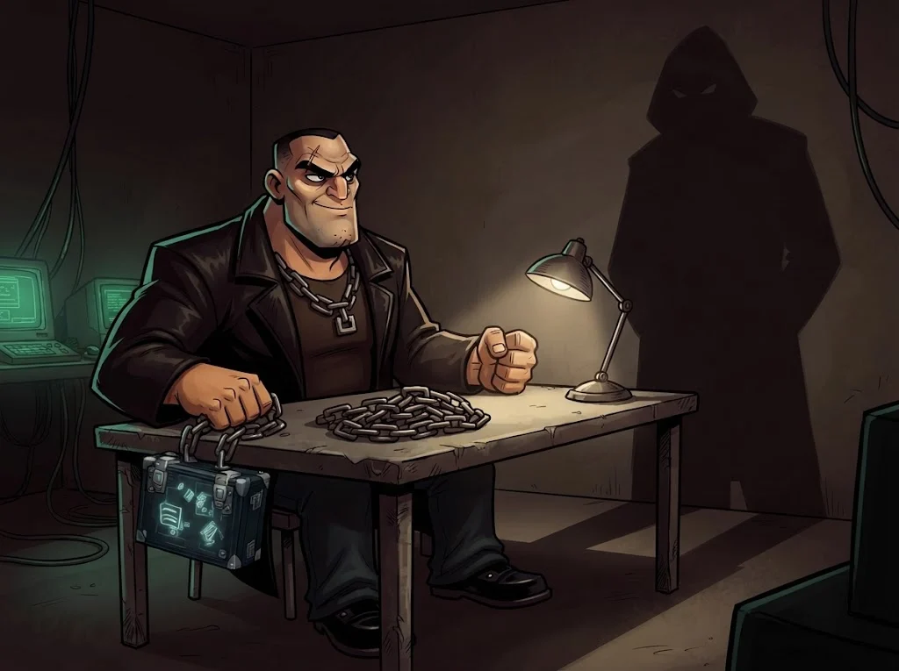

# M10 Quiz: Saldırı ve savunma temelleri

8 soru · geçme notu %70.

> 🔒 **DOSYA KAPANDI: Fidyeci Ferhat** · *quiz'i %70 ile geçince*
>
> 
>
> Zincir üçüncü halkada kırıldı; yedekler kurtarıldı. Ferhat sorguda tek cümle kuruyor: "Don'u yakalarsınız. Ama Baron'u asla."
>
> ➡️ *Sıradaki dosya: **Don Gölge** (M11)*
