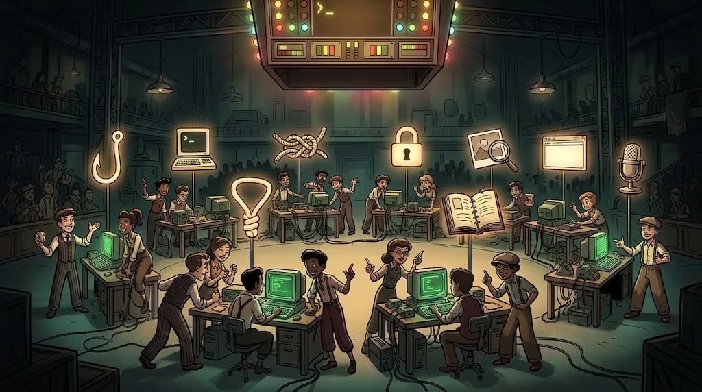

# Your First Cyber Security Operation — mini CTF

> Week 12: for the first time you use what you learned over 11 weeks as a **team** on a real mission.
> A CTF (*Capture The Flag*): every mission you solve gives you a "flag".

::cizgi[m11-01-sahne]

> 🕴️ **FILE: Don Shadow** · *Head of the Family*
>
> 
>
> **Threat:** The finale — a mini CTF where all the techniques come together. · [Shadow Network story →](../../00-program/09-golge-ag.md)

::cizgi[don-acilis]

## Format

- **Team:** 3–4 people, from different departments if possible.
- **Duration:** 3 hours.
- **Missions:** 8 areas, easy to hard (1–2 missions per area).
- **Flags:** in the form `ORDEK{...}` and entered on the club's **separate CTF platform** (CTFd).
  Ördek Club does not verify flags; in the Academy you submit only the solution report.

## 8 mission areas

| # | Area | Which module? |
|---|---|---|
| 1 | Signs of a digital scam | M01, M10 |
| 2 | Basic Linux commands | M04 |
| 3 | Interpreting a network packet | M05 |
| 4 | Encryption puzzle | M08 |
| 5 | File metadata analysis | M09 |
| 6 | Reading HTTP requests | M06 |
| 7 | Fictional log analysis | M07 |
| 8 | Explaining the evidence found | M09, M10 |

## Success condition

Finding flags alone is **not enough**. Part of your score comes from the solution report:
*How did you find it, why did you choose that path, what did you try that didn't work?*

| | Points |
|---|---:|
| Flags (CTF platform) | 60% |
| Solution report | 30% |
| Teamwork and following the rules | 10% |

## Rules

- Only the targets and files given. Attacking the CTF infrastructure is **forbidden** and grounds for disqualification.
- Flags/solutions are not shared with other teams.
- You can get a hint when you're stuck; a hint reduces part of your score.

Warm-up missions: [Getting ready for the mission areas](02-isinma.md) · Report template: [Solution report](03-cozum-raporu.md)
