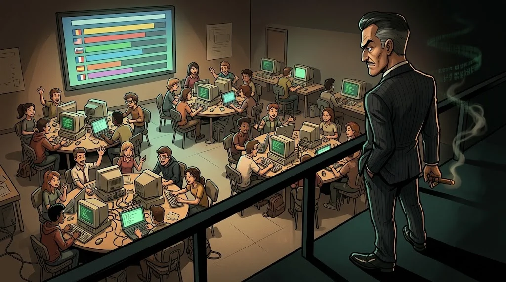
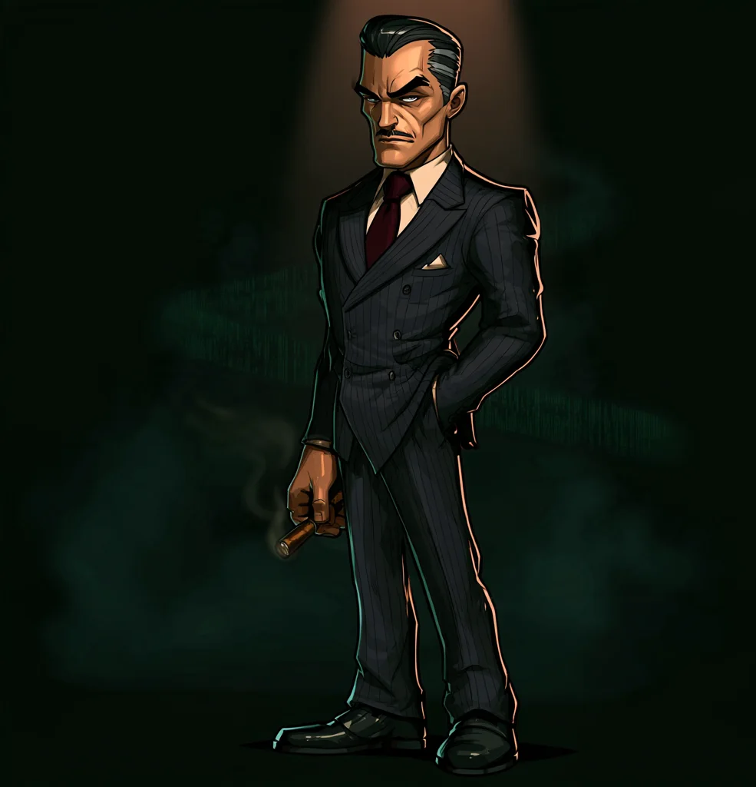

# İlk Siber Güvenlik Operasyonu — mini CTF

> 12. hafta: 11 haftada öğrendiklerini **takım** olarak ilk kez gerçek bir görevde kullanıyorsun.
> CTF (*Capture The Flag*): her çözülen görev bir "bayrak" verir.

> 🕴️ **DOSYA: Don Gölge** · *Ailenin Başı*
>
> 
>
> 📼 **Bölüm 11 — Son Masa.** Ailenin bütün dosyaları masanda. Don Gölge son bir oyun hazırladı: sekiz kilitli kapı, her birinde bir üyesinin hilesi. Öğrendiğin her şey tek gecede sınanacak.
>
> **Tehdit:** Final — tüm tekniklerin birleştiği mini CTF. · [Gölge Ağ hikâyesi →](../../00-program/09-golge-ag.md)

## Format

- **Takım:** 3–4 kişi, mümkünse farklı bölümlerden.
- **Süre:** 3 saat.
- **Görevler:** 8 alanda, kolaydan zora (her alanda 1–2 görev).
- **Bayraklar:** `ORDEK{...}` biçimindedir ve kulübün **ayrı CTF platformuna** (CTFd) girilir.
  Ördek Club bayrak doğrulamaz; Akademi'de yalnızca çözüm raporunu teslim edersin.

## 8 görev alanı

| # | Alan | Hangi modül? |
|---|---|---|
| 1 | Dijital dolandırıcılık belirtileri | M01, M10 |
| 2 | Basit Linux komutları | M04 |
| 3 | Ağ paketini yorumlama | M05 |
| 4 | Şifreleme bulmacası | M08 |
| 5 | Dosya metadata analizi | M09 |
| 6 | HTTP isteklerini okuma | M06 |
| 7 | Kurgusal log inceleme | M07 |
| 8 | Bulunan kanıtları açıklama | M09, M10 |

## Başarı koşulu

Sadece bayrak bulmak **yetmez**. Puanın bir kısmı çözüm raporundan gelir:
*Nasıl buldun, neden o yolu seçtin, neyi denedin ve işe yaramadı?*

| | Puan |
|---|---:|
| Bayraklar (CTF platformu) | %60 |
| Çözüm raporu | %30 |
| Takım çalışması ve kurallara uyum | %10 |

## Kurallar

- Yalnızca verilen hedefler ve dosyalar. CTF altyapısına saldırmak **yasak** ve diskalifiye sebebi.
- Başka takımlarla bayrak/çözüm paylaşılmaz.
- Takıldığınızda ipucu alabilirsiniz; ipucu puanın bir kısmını düşürür.

Isınma görevleri: [Görev alanlarına hazırlık](02-isinma.md) · Rapor şablonu: [Çözüm raporu](03-cozum-raporu.md)
