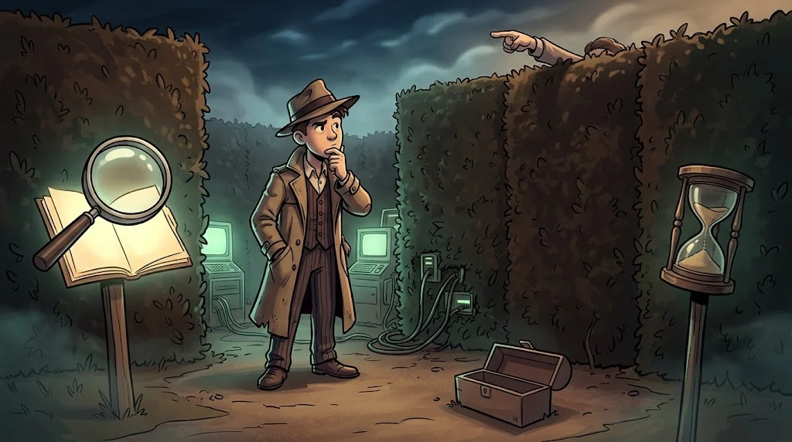

# Warm-up round

> A 2–5 minute mini mission for each area. No flags — the aim is to **recall the method**.


## 1. Scams — the 30-second rule
"Your scholarship is approved! Update your details at kku-burs.example." → How many signs can you count?

## 2. Linux
```bash
find ~ -name ".*" -maxdepth 1     # hidden files
grep -ri "ordek" ~/isinma 2>/dev/null
```

## 3. Network packet
What does the filter `tcp.flags.syn == 1 && tcp.flags.ack == 0` show? (M05-08)

## 4. Encryption puzzle
```text
T3JkZWsgQWthZGVtaQ==
```
This text ends with `==`; which encoding is it? Decode it. (Hint: M04-06)

## 5. Metadata
```bash
exiftool fotograf.jpg | grep -i date
```
Was the photo taken on the day it claims?

## 6. HTTP
```http
HTTP/1.1 302 Found
Location: /login?next=/admin
```
What happened? Why 302, why `/login`?

## 7. Log
In the line `Accepted password for deploy from 203.0.113.66`, what should you look for before it? (M07-07)

## 8. Presenting evidence
Write a finding in one line as **finding + source + evidence + confidence**. (M09-04)

## When you're stuck, 4 steps



1. **Read the question again** — the title and the description often contain the hint.
2. **Find the file's type** — the `file dosya` command, don't trust the extension.
3. **Start simple** — `strings`, `cat`, decode Base64, `exiftool`.
4. **The 15-minute rule** — if there's no progress, hand it to a teammate or take a hint.

<details><summary>Answers for 4 and 6</summary>4: Base64 → "Ordek Akademi". 6: The server redirected you to the sign-in page because you had no session; after signing in you'll be returned to /admin.</details>

## 🧪 Try it (15 min)

Share out the 8 warm-ups with your team; each person explains their area to the others in 2 minutes.

## ✅ Remember

- First find the file's type, then start with simple tools.
- If there's no progress after 15 minutes, change your method.
- A CTF is a team sport: share out the areas.
