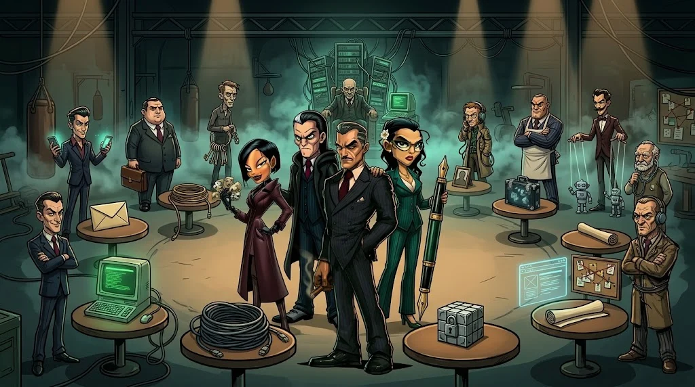

# Isınma turu

> Her alan için 2–5 dakikalık bir mini görev. Bayrak yok — amaç **yöntemi hatırlamak**.



## 1. Dolandırıcılık — 30 saniye kuralı
"Bursunuz onaylandı! Bilgilerinizi kku-burs.example adresinden güncelleyin." → Kaç işaret sayabilirsin?

## 2. Linux
```bash
find ~ -name ".*" -maxdepth 1     # gizli dosyalar
grep -ri "ordek" ~/isinma 2>/dev/null
```

## 3. Ağ paketi
`tcp.flags.syn == 1 && tcp.flags.ack == 0` filtresi neyi gösterir? (M05-08)

## 4. Şifreleme bulmacası
```text
T3JkZWsgQWthZGVtaQ==
```
Sonu `==` ile biten bu metin hangi kodlamadır? Çöz. (İpucu: M04-06)

## 5. Metadata
```bash
exiftool fotograf.jpg | grep -i date
```
Fotoğraf iddia edildiği gün mü çekilmiş?

## 6. HTTP
```http
HTTP/1.1 302 Found
Location: /login?next=/admin
```
Ne oldu? Neden 302, neden `/login`?

## 7. Log
`Accepted password for deploy from 203.0.113.66` satırından önce ne aramalısın? (M07-07)

## 8. Kanıt anlatma
Bir bulguyu **bulgu + kaynak + kanıt + güven** ile tek satırda yaz. (M09-04)

## Takıldığında 4 adım

1. **Soruyu yeniden oku** — Başlık ve açıklama çoğu zaman ipucu içerir.
2. **Dosyanın türünü bul** — `file dosya` komutu, uzantıya güvenme.
3. **Basitten başla** — `strings`, `cat`, Base64 çöz, `exiftool`.
4. **15 dakika kuralı** — İlerleme yoksa takım arkadaşına devret ya da ipucu al.

<details><summary>4 ve 6 için cevaplar</summary>4: Base64 → "Ordek Akademi". 6: Sunucu oturum olmadığı için seni giriş sayfasına yönlendirdi; girişten sonra /admin'e döneceksin.</details>

## 🧪 Dene (15 dk)

Takımınla 8 ısınmayı paylaştırın; herkes kendi alanını 2 dakikada diğerlerine anlatsın.

## ✅ Akılda kalsın

- Önce dosyanın türünü bul, sonra basit araçlarla başla.
- 15 dakika ilerleme yoksa yöntemi değiştir.
- CTF bir takım sporudur: alanları paylaşın.
