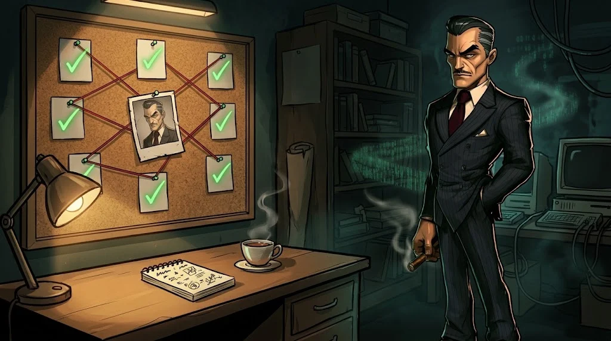
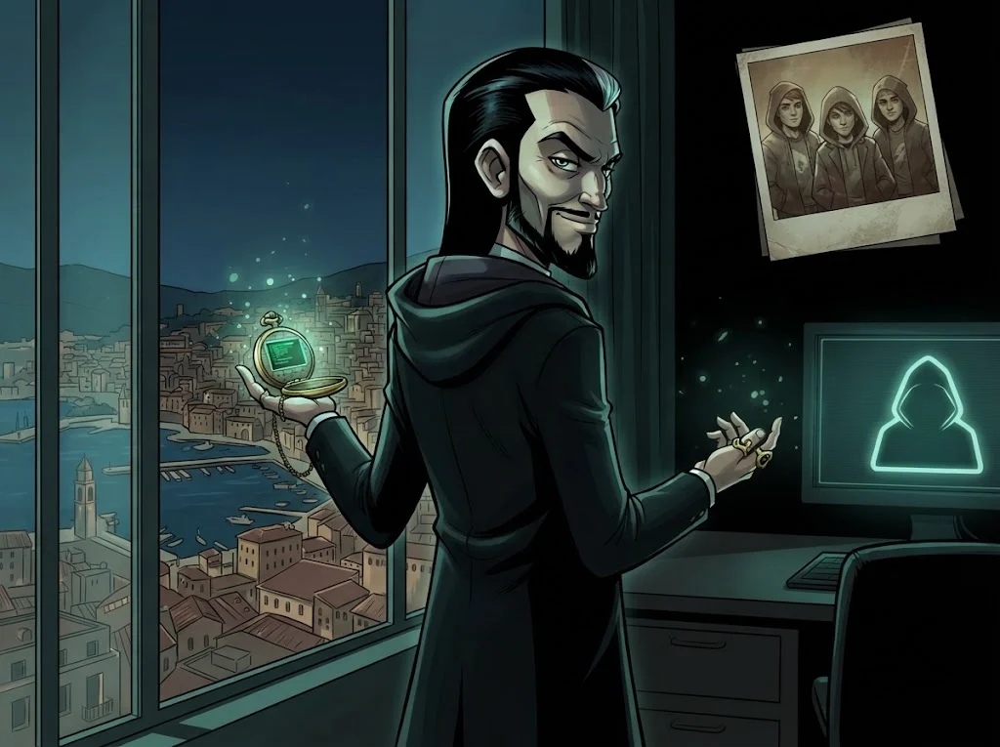

# Uygulama: Çözüm raporu

> Bir bayrağı bulmak bir kez işe yarar. **Nasıl bulduğunu yazmak** bir dahaki sefere de işe yarar.



## Teslim kuralları

- Takım başına **bir** rapor, CTF bitiminden sonraki 48 saat içinde.
- Her çözülen görev için aşağıdaki şablon; çözülemeyenler için de "denediklerimiz" bölümü.
- Bayrağın kendisini rapora **yazmayın** (`ORDEK{...}` yerine "bayrak bulundu" yeterli) — rapor sonra diğer öğrencilerle paylaşılabilir.

## Şablon (görev başına)

```text
Görev: [ad] · Alan: [1–8] · Çözen: [isimler]

1. Ne verildi?
   (dosya, adres, açıklama — tek cümle)

2. İlk gözlem
   (dosyanın türü, dikkat çeken şey)

3. Çözüm adımları
   - Adım 1: komut/araç + neden
   - Adım 2: ...
   (Komutları kopyalanabilir biçimde yazın.)

4. Bayrağa nasıl ulaşıldı?
   (bayrağı yazmadan)

5. Neyi denedik ve işe yaramadı?

6. Gerçek hayatta karşılığı ve savunma
   (Bu zafiyet/teknik gerçek bir sistemde nasıl önlenirdi?)
```

## Değerlendirme

| Ölçüt | Puan |
|---|---:|
| Adımlar başka biri tarafından tekrarlanabilir mi? | 4 |
| "Neden" açıklanmış mı (sadece "ne" değil)? | 3 |
| Başarısız denemeler dürüstçe yazılmış mı? | 1 |
| Savunma önerisi gerçekçi mi? | 2 |

## ✅ Akılda kalsın

- İyi rapor, başka birinin aynı yolu yürüyebileceği rapordur.
- "Neden" sorusunun cevabı puandan daha değerlidir.
- Her teknik bulgu bir savunma önerisiyle biter.

> 🔒 **DOSYA KAPANDI: Don Gölge** · *raporunu teslim edince*
>
> 
>
> Don Gölge'nin dosyası kapandı. Tam o anda ekranında bir mesaj beliriyor, imza tek harf: "İyi oyundu Tilki. Selim'e selamımı söyle. — B." Selim Hoca çekmecesinden yirmi yıllık bir fotoğraf çıkarıyor: üç kapüşonlu genç. "Eren..." diyor. Sezon 2 uzmanlık yollarında başlıyor.
>
> ➡️ *Sezon 2: **Tek Tırnak Jasmine** ve uzmanlık yolları*
