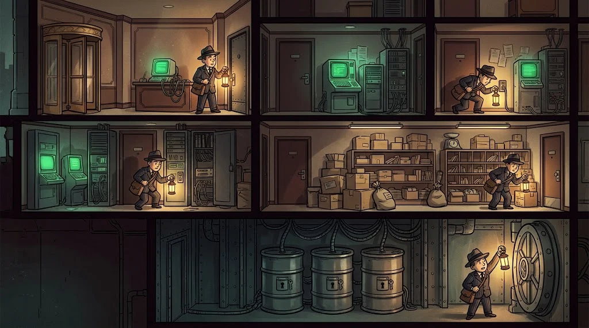

# Path A — Web Application and API Security

> Where do the apps you use every day break, and how are they fixed? **Web pentesting** and **application security**.

::cizgi[a-00-sahne]

> 🕴️ **FILE: Single-Quote Jasmine** · *Queen of Databases*
>
> 
>
> **Who is she?** The third of the Hoods; she stayed at Eren's side that night. The Baron's right hand, Puppeteer Orhan's master.
> [Shadow Network story →](../../00-program/09-golge-ag.md)

::cizgi[jasmine-acilis]

**Prerequisite:** HTTP, web fundamentals (M06), Linux (M04)

## 12 lessons

| # | Lesson | In one sentence |
|---|---|---|
| A01 | [Web security lab](01-web-laboratuvari.md) | Catch a request with Burp Suite, change it, send it again |
| A02 | [Reconnaissance and asset inventory](02-kesif.md) | Learn what the target owns, passively and within scope |
| A03 | [Access control and IDOR](03-erisim-kontrolu-idor.md) | The question "can I see someone else's data?" |
| A04 | [Account and session security](04-hesap-ve-oturum.md) | Password reset, cookies, JWT and MFA |
| A05 | [Injection](05-injection.md) | SQL and NoSQL injection; parameterised queries |
| A06 | [Browser side](06-tarayici-tarafi.md) | XSS, CSRF, CORS and CSP |
| A07 | [File handling](07-dosya-isleme.md) | Uploads, path traversal, LFI/RFI |
| A08 | [Server side](08-sunucu-tarafi.md) | Command injection, SSTI, SSRF, XXE |
| A09 | [API and business logic](09-api-ve-is-mantigi.md) | OAuth, rate limiting, race conditions |
| A10 | [CMS and the supply chain](10-cms-ve-tedarik-zinciri.md) | WordPress/Joomla, plugins, SBOM |
| A11 | [Advanced testing and defence](11-ileri-test-ve-savunma.md) | WAFs, attack traces in logs, secure code |
| A12 | [Final](12-final-rapor.md) | Scope → finding → CVSS → professional report |

## Capstone output

A **security assessment report** for a fictional web application.

## Where do you practise?

Only on **Ördek Lab** targets and applications prepared for training (e.g. OWASP Juice Shop).
No scanning or testing is done on real sites.
