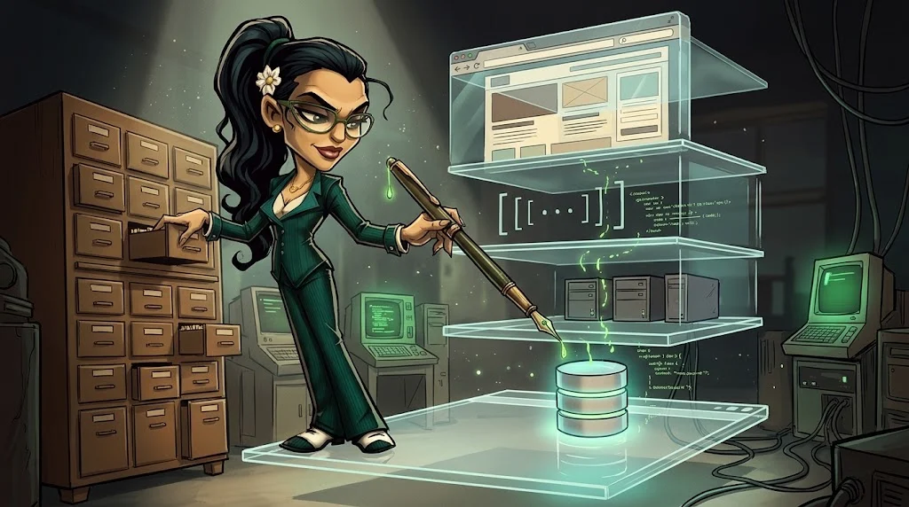

# Yol A — Web Uygulaması ve API Güvenliği

> Her gün kullandığın uygulamalar nerede kırılır, nasıl düzeltilir? **Web pentest** ve **uygulama güvenliği**.

> 🕴️ **DOSYA: Tek Tırnak Jasmine** · *Veritabanı Kraliçesi*
>
> 
>
> 📼 **Bölüm — Sezon 2: Çekmeceler.** Don'un dosyası kapandı ama Kampüs Portalı'nda gece yarısı tuhaf sorgular dönüyor.
> Notlar, burslar, kimlik fotoğrafları: hepsi bir veritabanının çekmecelerinde. Selim Hoca imzalı bir test izniyle seni
> portalın laboratuvar kopyasına gönderiyor: Jasmine'den önce her çekmeceyi bul ve kilitle.
>
> **Kim o?** Kapüşonlular'ın üçüncüsü; o gece Eren'in yanında kaldı. Baron'un sağ eli, Kuklacı Orhan'ın ustası.
> [Gölge Ağ hikâyesi →](../../00-program/09-golge-ag.md)

**Ön koşul:** HTTP, web temelleri (M06), Linux (M04)

## 12 ders

| # | Ders | Tek cümleyle |
|---|---|---|
| A01 | [Web güvenliği laboratuvarı](01-web-laboratuvari.md) | Burp Suite ile isteği yakala, değiştir, tekrar gönder |
| A02 | [Keşif ve varlık envanteri](02-kesif.md) | Hedefin neye sahip olduğunu pasif ve kapsam içinde öğren |
| A03 | [Erişim kontrolü ve IDOR](03-erisim-kontrolu-idor.md) | "Başkasının verisini görebiliyor muyum?" sorusu |
| A04 | [Hesap ve oturum güvenliği](04-hesap-ve-oturum.md) | Parola sıfırlama, cookie, JWT ve MFA |
| A05 | [Injection](05-injection.md) | SQL ve NoSQL injection; parametreli sorgu |
| A06 | [Tarayıcı tarafı](06-tarayici-tarafi.md) | XSS, CSRF, CORS ve CSP |
| A07 | [Dosya işleme](07-dosya-isleme.md) | Yükleme, path traversal, LFI/RFI |
| A08 | [Sunucu tarafı](08-sunucu-tarafi.md) | Command injection, SSTI, SSRF, XXE |
| A09 | [API ve iş mantığı](09-api-ve-is-mantigi.md) | OAuth, rate limiting, race condition |
| A10 | [CMS ve tedarik zinciri](10-cms-ve-tedarik-zinciri.md) | WordPress/Joomla, eklentiler, SBOM |
| A11 | [İleri test ve savunma](11-ileri-test-ve-savunma.md) | WAF, loglarda saldırı izi, güvenli kod |
| A12 | [Final](12-final-rapor.md) | Kapsam → bulgu → CVSS → profesyonel rapor |

## Bitirme çıktısı

Kurgusal bir web uygulaması için **güvenlik değerlendirme raporu**.

## Nerede pratik yaparsın?

Yalnızca **Ördek Lab** hedeflerinde ve eğitim için hazırlanmış uygulamalarda (ör. OWASP Juice Shop).
Gerçek sitelerde tarama ve test yapılmaz.
